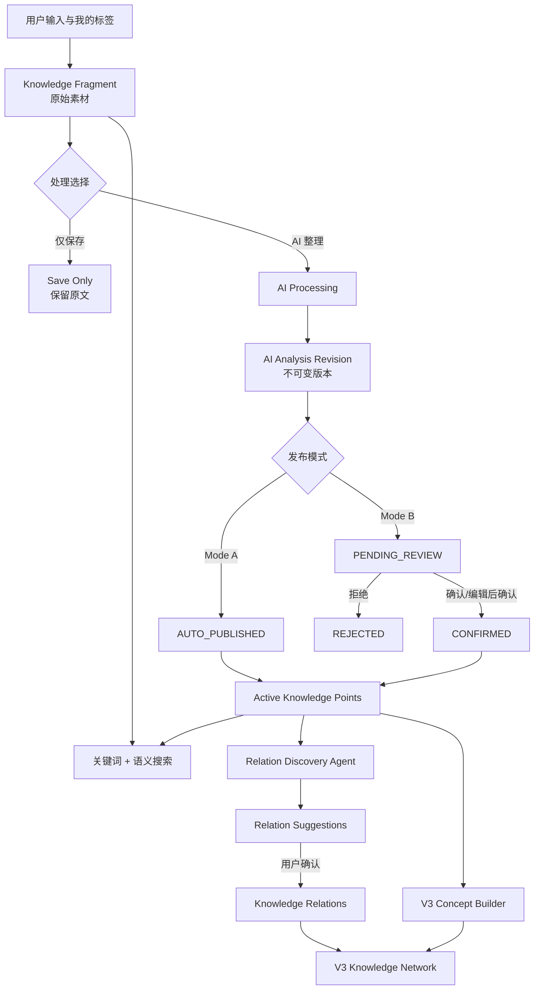

# AI 个人知识管理系统 PRD

> 版本：1.0  
> 状态：V1 需求基线（已确认）  
> 日期：2026-08-09

## 1. 产品概述

### 1.1 产品定位

AI 个人知识管理系统帮助用户把零散、无结构的素材沉淀为可检索、可修正、可复用的个人知识，使用户在遇到真实问题时能够找回并使用过去学过的内容。

产品不替代学习和判断。用户负责输入、修正与确认，AI 负责理解、整理、扩展和提出建议。

### 1.2 核心价值

```text
低成本收集
    ↓
AI 结构化整理
    ↓
用户确认与修正
    ↓
可追溯的知识点
    ↓
真实问题下的检索与复用
```

与普通笔记工具相比，本产品的差异不是“替用户生成一篇更漂亮的笔记”，而是同时保留：

1. 原始素材的历次用户版本；
2. AI 的历次理解；
3. 用户最终采用和修正后的知识。

### 1.3 当前核心价值判断

当前阶段的第一核心价值是：

> 当用户遇到一个真实问题时，能够迅速找回、核验并复用过去保存或学习过的知识。

因此：

- 低成本收集是入口，不是最终成功标准；
- 主要输入是琐碎、彼此关联较弱的知识片段；
- 产品首先优化“从问题到相关知识点和原始上下文”的路径；
- 主动发现知识缺口、关系和知识图谱不是当前阶段的第一核心需求，但素材并非完全没有关联；少量高价值关联仍值得发现，因此 Relation Discovery 与知识网络继续保留在 V2/V3 明确路线中。

## 2. 背景与问题

个人知识通常分散在文章摘录、工作经验、临时想法和学习笔记中，存在以下问题：

- 输入无结构，整理成本高，最终停留在“收藏”；
- 一篇素材可能包含多个独立知识点，传统笔记粒度过粗；
- 标签容易随时间失控，关键词搜索难以回答自然语言问题；
- AI 生成结果可能错误，若直接覆盖原文或正式知识，无法追溯和纠正；
- 自动生成的关系噪声大，未经确认的知识图谱不可信；
- 模型升级后重新分析可能改变旧结果，破坏用户已有分类和关联。

## 3. 产品目标与非目标

### 3.1 产品目标

- 让用户在较低输入成本下保存一份完整、可追溯的原始素材；
- 将素材拆成可独立理解和检索的知识点；
- 让 AI 建议、用户确认和用户修正始终可区分；
- 让用户通过关键词或自然语言问题快速找到并复用已有知识；
- 让检索结果能回到原始上下文，以便用户核验和继续思考；
- 支持 AI 重新分析，同时不静默覆盖已生效知识。

### 3.2 非目标

- 不替用户自动完成学习或判断；
- 当前版本只接收不超过 1000 个 Unicode 扩展字素簇（用户感知字符）的纯文本 Fragment，不解析 Markdown、HTML 或富文本，不提供外部出处字段，也不处理长文章、整份文档或独立 Source Material；
- V1 不做图数据库、复杂图谱编辑和路径探索；
- V1 不基于检索结果生成 AI 答案或聊天回复；自然语言仅作为检索查询；
- V1/V2 不创建 Concept，Concept 与正式知识网络统一放到 V3；
- 不在早期版本建设完整行业 Ontology；
- 不在 V1 支持团队协作、公开知识库或多人权限体系；
- V1 严格采用单用户数据模型，不内置登录、注册、会话、密码找回或多租户隔离；
- V1 只交付 PC Web；不开发原生桌面端、移动 Web 或原生移动端，也不为移动设备建立布局与交互验收基线；
- 不以主动知识缺口分析、弱关联推荐或图谱规模衡量当前产品是否成功；
- 不把未经用户确认的 AI 关系当作事实。

## 4. 目标用户与核心场景

### 4.1 目标用户

首要用户是持续学习、需要积累专业知识的个人，例如开发者、产品经理、研究者和知识工作者。

### 4.2 核心场景

1. 用户输入一段不超过 1000 个用户感知字符的摘录、工作经验或临时想法，选择或新建至少一个“我的标签”并保存；
2. 用户可以只保存原始 Fragment，也可以请求 AI 整理；
3. 选择 AI 整理时，AI 生成 Fragment 的整体标题与摘要，以及一个或多个带标题、正文和候选标签的 Knowledge Point；
4. 用户在自动发布或人工审查模式下采用、修改或拒绝结果；
5. 用户用自然语言检索知识，并回到对应原始素材核验上下文；
6. 模型升级后，用户重新分析旧素材并比较新旧版本；
7. 系统发现两个知识点可能存在类比、依赖或对比关系，用户决定是否确认；
8. V3 中，用户把多个知识点沉淀为 Concept，并浏览个人知识网络。

## 5. 产品原则

### 5.1 原始素材可由用户修正，但不可被覆盖

Knowledge Fragment 是事实来源的逻辑对象。用户首次保存或编辑内容时都会产生一个不可变的 Fragment Revision，旧版本始终可回看；AI 只能针对具体 Fragment Revision 生成分析版本和知识点，不能改写任何原文版本。用户应始终可以从知识点回到产生它的确切原文版本。

### 5.2 所有 AI 衍生内容均可追溯

Fragment 的整体标题与摘要，以及 Knowledge Point 的标题、正文和 AI 标签原始文本都属于 AI 分析结果，必须记录来自哪一次分析。版本化不能只覆盖标签。

### 5.3 “最新生成”不等于“当前生效”

系统分别维护最近生成的分析版本和生效版本。重新分析产生新候选，但不会静默替换当前生效结果。

### 5.4 用户修正采用叠加层

用户对 Fragment 整体标题与摘要以及 Knowledge Point 标题与正文的修正不改写 AI 原始输出；标签则通过升级候选 Tag 或屏蔽、恢复 Tag Assignment 管理，不把关联改写成内容修正。用户内容修正可以纠正或补充原文没有表达的内容，因为它代表用户自己的认知，而不是 AI 对原文的有据提炼；系统必须明确它由用户撰写。默认展示和搜索使用“生效 AI 版本 + 用户修正”形成的有效知识视图。

### 5.5 AI 关系必须经人工确认

关系发现的置信度只用于排序，不代表事实。关系建议只有经过用户确认，才能成为知识关系。

### 5.6 自动发布不等于用户确认

草案中的 `AUTO_CONFIRMED` 统一改名为 `AUTO_PUBLISHED`。系统自动采用的结果必须与用户主动确认的 `CONFIRMED` 明确区分。

### 5.7 保存与 AI 整理解耦

保存原文不代表必须请求 AI 整理。用户可以选择“仅保存”，让 Fragment 保持无知识点的原始状态并直接参与 Fragment 搜索；也可以在保存时或以后主动发起 AI 整理。Mode A/B 只决定 AI 结果如何发布，不决定是否调用 AI。

实例尚无通过测试的模型配置时，系统仍允许保存记录，但保存界面强制使用“仅保存”并禁用 AI 整理；这不是 `PROCESSING_FAILED`。配置成功后，用户可以对这些记录主动发起 AI 整理。只有已经存在有效配置、任务启动后发生的服务错误才进入正常的处理失败流程。

### 5.8 用户只操作“记录”

Fragment、Fragment Revision、AI Analysis Revision 和 Knowledge Point 是内部领域对象。V1 用户只创建、编辑、浏览和搜索“记录”：每条记录保留原文，并可包含 AI 标题、摘要和一个或多个知识点。用户不需要判断录入内容属于 Fragment 还是 Knowledge Point，也不提供独立手动创建 Knowledge Point 的入口。

### 5.9 V1 的 AI 只做有据整理

AI 可以改写、归纳和按最小必要原则拆分原文，但 Fragment 级标题、整体摘要和 Knowledge Point 正文中的事实性陈述必须由对应 Fragment Revision 支持。V1 不把外部背景、例子、事实或新结论混入整理结果；知识扩展作为未来独立能力评估，不能冒充原文提炼。

### 5.10 V1 是单用户应用

V1 不建立应用内账号和多租户模型。默认本地部署只监听回环地址；需要远程访问时，由反向代理或部署平台提供认证、TLS 和网络访问控制。未来若支持多用户，需要单独设计数据所有权与迁移，不在 V1 数据表中预埋 `user_id`。

### 5.11 AI 整理内容统一使用中文

无论 Fragment Revision 的原文语言，AI 生成的 Fragment 标题与整体摘要、Knowledge Point 标题与正文都使用中文自然语言。产品名、技术缩写、API、代码标识符和没有合适译名的专有名词保留其常用原写法。AI 候选标签中的通用概念使用中文，产品名、技术缩写和业内常用专名保留标准写法，例如“数据同步”“事件驱动”与 `Redis`、`CDC`、`Kafka`；不生成同一候选的中英双写形式。翻译和归纳仍受有据整理约束，不能借跨语言改写加入原文没有的信息。该规则不翻译 Fragment 原文、Evidence Span 或用户修正，也不限制用户手动创建标签的语言；“仅保存”记录仍直接使用原文首个非空行作为展示标题。

### 5.12 V1 使用一套包含两个独立端点的实例模型配置

V1 只维护一套供全部记录和后台任务共用的实例模型配置，但配置内部必须拆分为两个独立的 OpenAI-compatible 端点：文本推理端点用于 AI 整理，Embedding 端点用于向量生成。两个端点分别保存自己的 Base URL、服务端凭据和模型标识，可以指向不同厂商或服务；不提供多配置档案或逐记录模型选择。候选配置包含两个端点的完整快照，分别测试通过后才原子启用，不能只发布其中一半。AI Analysis Revision 保存实际使用的文本推理模型与非敏感配置版本，但不保存凭据；修改文本推理端点不会自动重新分析历史内容。Embedding 端点的 Base URL 或模型标识变化会使现有向量身份失效，系统必须暂停语义搜索并重建全部向量；关键词搜索继续可用。只有全量新向量校验成功并一次性激活后才恢复语义搜索，不能保留旧端点在线或混合检索不同配置生成的向量。

### 5.13 记录正文是原样纯文本

Fragment Revision 的正文以纯 Unicode 字符串保存，保留用户输入的换行与空白；Markdown 标记、HTML 标签和代码围栏都只是普通字符，界面不得解析或执行。显示时必须安全转义，并使用保留空白的文本呈现方式。AI 整理、用户修正和证据定位都以该纯文本为依据。V1 不提供 Markdown 预览、富文本编辑器或隐藏格式节点。1000 字上限按 Unicode 扩展字素簇（用户感知字符）计算：一个完整 Emoji 或组合字符算 1 个字符，每个空格、Tab 和换行也分别算 1 个，首尾空白同样计入；计数过程不改变原始字符串。正文必须至少包含一个非 Unicode 空白字符；空字符串或纯空白正文不能创建，也不能保存为新的 Fragment Revision，但有效正文的首尾空白不得因此被裁剪。

### 5.14 V1 只交付 PC Web

V1 唯一支持并验收的操作体验是 PC Web，包括记录整理、AI 审查、版本比较、证据核验、标签管理和模型设置。移动 Web、原生移动端和原生桌面端均不在 V1 范围内；V1 不为手机尺寸、触控导航或移动性能建立设计与验收要求。

## 6. 版本范围

| 版本 | 核心目标 | 包含 | 不包含 |
| --- | --- | --- | --- |
| V1 | 建立可用的知识整理与检索闭环 | 不超过 1000 个用户感知字符的纯文本输入、统一标签词表、仅保存或 AI 整理、AI 标题/摘要/知识点/候选标签、Mode A/B、版本化、关键词与简单语义搜索 | 重复检测与合并、长文章与文件导入、独立 Source Material、Concept、正式关系网络、图数据库 |
| V2 | 增强知识质量并发现关联 | 标签规范化与批量修正、重复检测、合并建议、关系建议与人工确认、实验性知识覆盖分析 | Concept、图谱展示、复杂路径探索 |
| V3 | 形成个人知识网络 | Concept Candidate、用户确认 Concept、知识点归属、正式关系类型、图谱展示、路径探索 | 全自动且无需确认的知识图谱 |

说明：V1 已生成基础 AI 候选标签；V2 的标签增强指同义词归一、批量治理和跨知识点建议，不是第一次引入标签。

V2 收尾至 V3 的分阶段实施顺序、阶段边界和逐阶段验收门见 [`docs/V3-ROADMAP.md`](docs/V3-ROADMAP.md)。该路线细化交付顺序，不替代本 PRD 的最终范围和完成标准。

## 7. 核心领域模型

### 7.1 Knowledge Fragment 与 Fragment Revision

Knowledge Fragment 是用户持续维护的一条原始素材；Fragment Revision 是每次保存后形成的不可变内容快照。

核心语义：

- Fragment 保留逻辑身份；记录级用户 Tag Assignment 独立关联到 Fragment；
- 每个尚未永久删除的 Fragment 持久化后至少具有一个指向 `USER_APPROVED` Tag 的 `ACTIVE` 记录级用户 Tag Assignment；AI 候选和知识点级 AI Assignment 不满足该不变量；
- 首次保存和每次用户编辑原文都会新增 Fragment Revision，不覆盖旧版本；
- 记录级用户 Tag Assignment 以最终集合原子更新；只修改标签关联不创建 Fragment Revision，也不触发 AI 分析，但更新后的集合不得为空；
- 系统明确区分当前 Fragment Revision 与历史版本；
- AI Analysis Revision 必须绑定到一个确切的 Fragment Revision；
- 当前版本中单条输入不超过 1000 个 Unicode 扩展字素簇（用户感知字符），不保存 URL、书名或出处等独立外部来源元数据，也不建模完整来源文档；出处本身有价值时，用户可以将其作为正文的一部分录入；
- AI 整理是用户可选动作；选择“仅保存”的 Fragment 可以没有 AI Analysis Revision 和 Knowledge Point；
- 每份成功完成 AI 整理的有效知识碎片必须产生一个或多个知识点；
- AI 不修改原始内容；
- 用户可以归档碎片，但归档不等于物理删除；
- 记录存在任何未结束的 AI 任务时不能归档；任务成功、失败、服务端超时或系统终止后才恢复归档资格；
- 用户可以恢复归档记录；也可以通过独立的永久删除操作，在二次确认后不可恢复地删除记录拥有的全部数据；
- 所有衍生知识必须保留到碎片的来源链路。

### 7.2 AI Analysis Revision（AI 分析版本）

一次 AI 处理产生一个不可变的分析版本，完整包含：

- Fragment 的建议标题；
- Fragment 的整体建议摘要；
- 标题与整体摘要共同以完整 Fragment Revision 为依据，不单独保存 Evidence Span；
- 1–5 个知识点组成的集合；通常为 1–3 个，每个知识点只包含标题与自包含正文，不另设摘要；
- 每个知识点引用的一个或多个 Evidence Span；
- 每个知识点的 AI 原始标签文本及 Tag Assignment；
- 所用模型、提示词或规则版本及生成时间；
- 分析状态与失败原因。

分析版本一经生成不再原地修改。重新分析创建新版本。

V1 不为 AI 标题、整体摘要或 Knowledge Point 正文设置产品级字符数硬上限，也不把长度单独作为输出校验失败条件。提示词要求内容简洁且不重复；系统完整保存合规输出，只在列表与搜索预览中按界面空间做显示截断，截断结果不写回分析版本。

异步任务完成时，系统必须再次核对它引用的 Fragment Revision 是否仍是该 Fragment 的当前版本。若用户已保存更新的原文版本，该结果仍按原引用完整保存，但分析版本标记为 `STALE`，其知识点不发布、不进入待审查或默认搜索，也不能替换生效版本。它只在历史版本中供追溯；用户需要整理当前原文时应针对当前 Fragment Revision 重新发起处理。

### 7.3 Knowledge Point（知识点）

知识点是可独立理解、检索和复用的最小知识单元。

核心语义：

- 必须引用一个确切的 Fragment Revision；不允许无 Fragment 来源的独立知识点；
- 每个成功处理的有效 Fragment 对应 1–5 个 Knowledge Point，通常为 1–3 个；即使 Fragment 本身已经是原子化表达也生成一个，但不为满足数量而过度拆分；
- 标题可以使用问题或主题形式，但正文必须给出可脱离标题独立理解的答案或知识陈述；
- 不能只生成“为什么不用轮询”一类空问题或目录标题；
- Knowledge Point 不单独生成摘要；搜索预览直接截取其自包含正文；
- V1 只由 AI 整理产生，用户可以修正、确认或拒绝，但不把它作为独立录入对象手动创建；
- 必须同时引用确切的 Fragment Revision 与 AI Analysis Revision；
- 正文中的事实性陈述必须由所引用的 Fragment Revision 支持，不得混入外部事实、例子或新结论；
- 必须具有一个或多个 Evidence Span，且每个片段都能在所引用的 Fragment Revision 原文中精确定位；
- 上述有据约束只校验 AI 原始结果；用户可以在独立的用户修正层纠错或补充原文没有的内容，Evidence Span 不因此被解释为用户补充内容的证据；
- AI 创建的知识点在发布前后具有明确状态；
- 已发布知识点另有不改变发布来源的 `usage_status`：默认 `INCLUDED`，用户执行“不采用”后为 `EXCLUDED`；
- 默认搜索只使用当前生效知识点；
- 待审查、已拒绝和旧版本结果不混入默认搜索结果。

### 7.4 标签

用户标签和 AI 候选标签共用一个实例级 `Tag` 词表，不建立两套标签表。

`Tag` 至少包含：

- `id`、`display_name`、`normalized_name`；
- 不可变的 `origin`：`USER_CREATED` 或 `AI_CREATED`；
- 可变的 `approval_status`：`CANDIDATE`、`USER_APPROVED` 或 `ARCHIVED`；
- `created_at` 与可选的 `user_approved_at`。

当前实例内 `normalized_name` 唯一。V1 依次使用 Unicode NFKC 统一兼容字符与全角/半角形式，去除首尾 Unicode 空白，将连续内部空白折叠为一个空格，并忽略拉丁字母大小写。标准化不删除标点，不翻译，也不执行词干化、缩写展开或同义词判断；它只用于唯一性比较，界面仍展示独立保存的 `display_name`。因此 ` CDC `、`cdc` 与全角 `ＣＤＣ` 共用一个 Tag，而 `C.D.C.`、`Change Data Capture` 仍是不同 Tag。

V1 假定按上述确定性规则标准化后同名即同义；同名异义由用户使用明确名称区分，例如 `Java（语言）` 与 `Java（地区）`。

用户创建或重命名 Tag 时，若计算出的 `normalized_name` 已存在，系统按重名拦截，不新建 Tag、不把新写法自动应用到已有 `display_name`，并引导用户选择现有 Tag。候选升级只改变认可状态，也不改展示名。AI 生成标准化同名的不同写法时复用现有 Tag，仅把本次原始写法保存在 Tag Assignment 的 `raw_label` 中，不得修改 `display_name`。只有用户显式重命名可以改变展示名，且新名称仍需通过同一唯一性校验。

V1 不合并不同名称的同义标签；例如 `CDC`、`Change Data Capture` 与 `变更数据捕获` 分别保留为不同 Tag。V2 提供用户维护的标签别名、手动或 AI 建议发起的批量合并和撤销合并。合并把一个或多个来源 Tag 可逆地解析到用户选择的 `USER_APPROVED` 主标签；来源 Tag、原始 `tag_id` 和全部历史 Tag Assignment 保持不变，不通过删除来源或批量改写关联伪造历史。有效展示、选择、搜索和后续建议按主标签聚合；撤销后来源 Tag 恢复独立生效。标签别名没有独立 Tag 身份或 Assignment，名称解析直接返回主标签。

`Tag Assignment` 独立保存标签挂载事实，至少记录：

- `tag_id` 与目标记录或 Knowledge Point；
- `assigned_by`：`USER` 或 `AI`；
- AI 关联对应的 `ai_analysis_revision_id` 与 `raw_label`；
- 关联状态，例如 `ACTIVE` 或 `SUPPRESSED`。

V1 对 Assignment 目标与创建者采用固定约束：用户手动创建的 Assignment 只能以整条 Record 为目标；AI Assignment 只能以其生成的 Knowledge Point 为目标。用户不能手动给单个 Knowledge Point 新增标签，也不能把 AI Assignment 改写成用户 Assignment；用户对知识点标签的操作只有升级对应 Tag 的认可状态，以及屏蔽或恢复某次 AI Assignment。同一个 Tag 可以同时以用户身份关联 Record、以 AI 身份关联其 Knowledge Point，记录详情聚合时按 `tag_id` 去重但保留两条来源事实。

用户新建标签时，Tag 直接为 `USER_CREATED + USER_APPROVED`，其语言不受系统限制。AI 每个 Knowledge Point 生成 1–5 个标签时，按 `normalized_name` 创建或复用 Tag；新词为 `AI_CREATED + CANDIDATE`。AI 对通用概念使用中文标签，对产品名、技术缩写和业内常用专名保留标准写法，不为同一候选生成中英双写或同时生成中英文两个 Tag。标签可以使用原文未逐字出现的标准术语或同义词，但必须由原文语义直接支持，不得加入只是在领域上相关的延伸概念。

用户升级 AI 候选标签时，同一 Tag 的 `approval_status` 变为 `USER_APPROVED`，不复制新行，也不把 `origin` 改成 `USER_CREATED`。所有历史 Tag Assignment 因引用同一 `tag_id` 而立即关联到已认可标签；各关联的 `assigned_by` 保持不变，错误关联可逐条屏蔽。标签库是 `USER_APPROVED` Tag 的视图，不是另一张表。

删除记录及其 Tag Assignment 后，仍有任一关联的 Tag 必须保留。没有任何剩余关联时，`USER_APPROVED` Tag 继续保留在标签库，`CANDIDATE` Tag 自动删除。

记录界面按认可状态展示：已认可标签进入“我的标签”，未认可标签进入“AI 候选”。同一个 Tag 在一条记录中去重展示，详细信息仍可查看关联由 AI 还是用户产生。Concept 在 V3 中是实体，不作为 Tag 使用。

### 7.5 Relation Suggestion 与 Knowledge Relation

V2 的关系发现只处理 Knowledge Point 与 Knowledge Point 之间的关系。

关系建议至少表达：

- 来源知识点和目标知识点；
- AI 建议的关系类型或关系描述；
- 判断理由和相关证据；
- 置信度；
- 产生建议的模型与分析版本；
- 当前审查状态。

用户确认后，它才成为知识关系。V3 再扩展 Concept 归属、Concept 间关系和正式图谱语义。

### 7.6 Concept（V3）

Concept 是用户确认后的长期认知节点，用于聚合多个知识点。

- AI 可以提出 Concept Candidate，但不能直接创建正式 Concept；
- 用户也可以主动创建 Concept；
- Concept Candidate、Concept 确认和知识点归属都属于 V3；
- V1/V2 的任何功能不得依赖 Concept 已存在。

## 8. 整体业务架构



## 9. 核心流程

### 9.1 收集与 AI 整理

1. 用户输入文本；
2. 用户必须选择或新建至少一个“我的标签”；V1 不显示或保存独立来源字段；
3. 系统立即保存知识碎片及首个不可变 Fragment Revision；
4. 存在有效模型配置时，系统默认选择“AI 整理 + Mode A”，用户可在本次保存时改为“仅保存”或把发布方式切换为 Mode B；没有有效配置时强制“仅保存”并禁用 AI 整理；
5. 选择“仅保存”时，系统不创建 AI Analysis Revision 或 Knowledge Point，记录原文直接参与搜索；用户以后仍可发起 AI 整理；
   列表与搜索以原文第一条非空行作为展示标题，过长时仅在界面截断，不新增或写回标题字段；
6. 选择“AI 整理”时，AI 针对该 Fragment Revision 异步生成一个完整分析版本；按最小必要原则生成 1–5 个 Knowledge Point，通常为 1–3 个。每个 Knowledge Point 可以用问题作标题，但必须包含自足的知识正文；
   AI 可以改写、归纳和拆分，但标题、摘要与知识点中的事实性陈述必须由该 Fragment Revision 支持；
   每个 Knowledge Point 同时生成一个或多个 Evidence Span，供用户点击后在对应原文版本中高亮核验；
7. 系统根据 Mode A/B 处理知识点；
8. 用户可从任一知识点回看原始素材和对应分析版本。

知识碎片处理状态：

```text
SAVED ── 请求 AI 整理 ──→ PROCESSING → PROCESSED
                                     ↘ PROCESSING_FAILED → RETRY

不存在未结束 AI 任务的稳定状态均可进入 ARCHIVED
```

`SAVED` 是正常状态，不代表处理失败。只有用户选择 AI 整理后，系统才进入 `PROCESSING`。如果 AI 未提取出至少一个有效知识点，本次处理不能标记为 `PROCESSED`，而应进入 `PROCESSING_FAILED` 并注明“未提取到知识点”。记录原文仍保留并可被搜索，用户可重试 AI 整理。

系统在保存 AI Analysis Revision 前校验完整输出，包括知识点数量为 1–5、必填字段存在、每个知识点具有非空标题与自包含正文、至少一个 Evidence Span、每个证据片段可在对应 Fragment Revision 中精确定位，以及结果可解析。首次校验失败自动重新生成一次；第二次仍失败则整次进入 `PROCESSING_FAILED`。系统不得发布合规子集，也不得通过截断、补写正文或伪造字段把不合规结果改成成功。

标题、摘要和知识点标题与正文未按中文自然语言输出，也属于整版校验失败；技术缩写、产品名、代码片段和专有名词保留原写法不算失败。

AI 内容长度不属于整版结构校验条件。系统通过生成提示词追求简洁，但不得仅因标题、摘要或正文较长而重试、判定失败或在持久化前截断。

### 9.2 Mode A：自动发布

适用于用户希望降低整理负担的场景。

当用户选择 AI 整理时，Mode A 是 V1 的默认发布方式。用户可以在单条 Fragment 上主动切换到 Mode B。

```text
AI_CREATED → AUTO_PUBLISHED
```

- 自动发布的知识点立即进入默认搜索；
- 界面必须标记“AI 自动发布”；
- 用户之后仍可编辑、转为人工确认，或执行可撤销的“不采用”；
- 系统不得把它展示为“用户已确认”。

### 9.3 Mode B：人工审查

适用于用户重视准确性或处理高价值素材的场景。

```text
AI_CREATED → PENDING_REVIEW → CONFIRMED
                            ↘ REJECTED
```

- 待审查知识点进入统一审查队列；
- 用户可修改标题与内容、升级候选 Tag 或屏蔽 AI 标签关联后确认；用户不能向单个 Knowledge Point 手动新增标签；
- 待审查与已拒绝内容不进入默认搜索；
- 对首次 AI 整理且不存在旧生效版本的 Fragment，用户逐个确认或拒绝 Knowledge Point；单个 Knowledge Point 一经确认便立即进入默认搜索，无需等待同批其他项目处理完成；
- 界面提供“全部确认”快捷操作，未处理项目继续保持 `PENDING_REVIEW`；
- 上述逐项生效仅适用于首次整理；编辑原文后的新分析和 Reanalysis 仍按 9.4 的整版原子切换规则处理。
- Fragment 级 AI 标题与整体摘要生成后立即作为辅助信息展示，并标记“AI 生成”；它们不需要单独审批，也不会使任何 Knowledge Point 变为 `CONFIRMED`。

在用户选择 AI 整理的前提下，V1 的应用级发布默认值为 Mode A，并允许用户修改全局默认值或在单次处理时覆盖该选择。

### 9.4 AI 重新分析与版本切换

本节明确区分两个动作：

- **重新分析（Reanalysis）**：原文未变化，针对同一个 Fragment Revision 再次运行 AI；
- **编辑原文后的处理**：用户保存新内容并创建新的 Fragment Revision；只有选择 AI 整理时才运行 AI。

重新分析必须覆盖所有 AI 衍生内容，而非只版本化标签。

流程：

1. 用户对某个知识碎片的指定 Fragment Revision 发起重新分析；
2. 系统生成新的 AI 分析版本；
3. 旧的生效版本和已有用户修正保持不变；
4. 新版本进入对比视图，展示新增、删除、拆分、合并及标签变化；
5. 用户可以采用新版本或丢弃新版本；
6. 采用后才切换生效版本，旧版本仍可回看。

保护规则：

- 即使应用默认使用 Mode A，重新分析也默认需要人工采用；
- 最近生成版本不得自动成为生效版本；
- 与旧知识点相关的已确认关系不得被重新分析静默删除；
- V1 支持整版采用或丢弃；逐知识点合并可在 V2 增强；
- 若新版本发生知识点拆分或合并，无法可靠对应的逐条标签屏蔽和知识关系应标记为“需要重新确认”。

用户编辑原文并保存新的 Fragment Revision 后，系统采用以下切换规则：

1. 用户可以为新 Fragment Revision 选择“仅保存”或“AI 整理”；选择 AI 整理时系统立即发起分析；
2. 若选择“仅保存”且已有生效分析，旧分析保持 `ACTIVE`，其知识点继续关联该 Fragment 并参与默认搜索；知识点仍引用实际生成它的旧 Fragment Revision，是否版本落后可由该引用与 Fragment 当前版本直接比较得出；
3. 分析期间，旧的生效 AI Analysis Revision 及其 Knowledge Point 继续参与默认展示和搜索；
4. 若本次编辑使用 Mode A，分析成功后系统以一次原子操作将新分析版本设为 `ACTIVE`，将旧分析版本设为 `SUPERSEDED`，并发布新知识点；
5. 若本次编辑使用 Mode B，新知识点进入 `PENDING_REVIEW`，旧版本继续生效；只有用户确认后才原子切换，拒绝则继续保留旧版本；
6. 若分析失败或未产生有效知识点，旧版本继续保持 `ACTIVE`，不出现搜索空窗，也不形成新旧知识点混合生效的中间状态；其知识点仍引用原先的 Fragment Revision；
7. 如果旧的生效知识中存在任何用户修正，V1 不自动迁移修正；即使本次选择 Mode A，新分析也进入待审查，旧版本继续生效，直到用户比较并确认后再原子切换。
8. 任一异步分析在进入 Mode A 或 Mode B 发布路径前，都必须确认其 Fragment Revision 仍是当前版本；若任务期间用户已保存更高版本，迟到结果标记为 `STALE` 并仅保留在历史中，不进入发布路径，也不改变 Fragment 当前处理状态。

上述自动切换只适用于用户确实修改了原文并产生新 Fragment Revision 的情况。仅对同一原文重新运行模型仍按重新分析流程处理，即使应用默认使用 Mode A，也必须由用户比较后主动采用。

这里的 `STALE` 仅描述“任务完成前来源版本已经过时、且结果从未生效”的分析版本。它不适用于此前已经生效、后来因用户仅保存新原文而出现来源版本落后的知识；后者仍保持 `ACTIVE` 并按普通规则搜索。

### 9.5 用户修正 AI 内容与标签

用户编辑 AI 生成的 Fragment 标题与整体摘要，或 Knowledge Point 标题与正文时，系统保存一层用户修正，不修改原始 AI 分析版本。

- 有用户修正时，有效知识视图优先显示用户值；
- 用户可以查看 AI 原值、用户修正值和修改时间；
- 用户修正可以包含 Fragment Revision 没有表达的纠错、补充或个人结论；保存时不执行 Evidence Span 支持性校验，也不自动修改原文或创建 Fragment Revision；
- 原有 Evidence Span 始终只核验 AI 原始 Knowledge Point。界面展示用户修正后的内容时，必须把证据入口标明为“AI 原始内容的证据”或使用等价表达，不得暗示它为用户新增内容背书；
- 用户可以撤销修正并恢复使用生效 AI 版本；
- 用户保存内容修正后，该知识点视为用户主动确认，状态变为 `CONFIRMED`；
- 重新分析不会自动删除或覆盖已有用户修正；若新版本无法与原知识点可靠对应，则要求用户复核。

对于已经处于 `AUTO_PUBLISHED` 或 `CONFIRMED` 的 Knowledge Point，用户可以执行可撤销的“不采用”。该操作只把独立的 `usage_status` 从 `INCLUDED` 改为 `EXCLUDED`：知识点立即退出当前有效知识视图、默认搜索和有效标签聚合，但 AI 原值、用户修正、发布来源和历史引用全部保留。恢复采用时将其改回 `INCLUDED`，原发布状态仍是此前的 `AUTO_PUBLISHED` 或 `CONFIRMED`。Mode B 发布前的 `REJECTED` 仍表示审查拒绝，不与发布后的可撤销排除混用。

`usage_status` 只属于该确切 Knowledge Point，不是需要跨分析版本记忆的用户偏好。重新分析或编辑原文产生新 AI Analysis Revision 时，系统不根据旧知识点的 `EXCLUDED` 状态强制人工审查，不判断新旧对应关系，也不迁移排除决定；Mode A 仍按普通规则切换，新知识点默认 `INCLUDED`，相似内容可以再次出现。旧状态仅随旧知识点保留为历史事实，不参与新版本发布判断。

用户不编辑 AI Analysis Revision 中保存的原始标签文本，而是操作统一 Tag 与 Tag Assignment：

1. 新建用户标签并关联到当前记录；用户手动 Tag Assignment 不以单个 Knowledge Point 为目标；
2. 将某个 AI 候选 Tag 升级为 `USER_APPROVED`；
3. 屏蔽或恢复某一次 Tag Assignment；
4. 查看标签最初来源以及每次关联由 AI 还是用户产生。

候选升级只改变同一 Tag 的认可状态，不复制标签，不改变不可变 `origin`。由于标准化同名标签共用同一 `tag_id`，升级后所有历史 Assignment 都立即关联到已认可标签；系统不需要逐条复制用户关联。历史关联的 `assigned_by` 继续保留，某条历史 AI 关联错误时可以单独屏蔽。

记录的有效标签集合由当前记录及其生效且 `usage_status = INCLUDED` 的 Knowledge Point 上所有 `ACTIVE` Tag Assignment 聚合并按 `tag_id` 去重。候选与已认可标签都可用于检索；界面分别展示“我的标签”和“AI 候选”。用户直接添加到记录的 Tag Assignment 不随 AI 重新分析消失；AI Assignment 则跟随对应分析版本和知识点使用状态生效或退出。若知识点被拆分或合并，不自动迁移无法可靠对应的逐条屏蔽决定，而是要求用户复核。

### 9.6 搜索

V1 的默认搜索语料同时包含：

- 未归档的 Knowledge Fragment，包括原文、ACTIVE Tag Assignment，以及已生成的有效 AI 标题与整体摘要；
- 发布状态为 `AUTO_PUBLISHED` 或 `CONFIRMED` 且 `usage_status = INCLUDED` 的 Knowledge Point，作为主要结构化结果；
- 不包含待审查、已拒绝、非生效分析版本和已归档内容。

V1 同时提供：

- 关键词搜索：同时检索 Fragment 原文、ACTIVE Tag Assignment、有效 AI 标题与整体摘要，以及 Knowledge Point 的标题和内容；
- 简单语义搜索：同时召回 Fragment 和 Knowledge Point，支持“为什么数据库同步不要轮询？”一类自然语言问题；
- 混合排序：综合文本匹配、向量相似度和用户修正后的标签。

内容生效与 Embedding 就绪相互独立。新 Fragment、发布后的 Knowledge Point 以及用户修正立即进入关键词搜索，对应搜索文档的 Embedding 异步生成；只有状态为 `READY` 的当前内容向量参与语义召回。内容变化时旧向量立即失效，不能继续代表新的有效内容。生成失败只让该搜索文档暂时退出语义召回，关键词搜索和内容展示保持可用，并提供重试。单条文档等待或失败不会暂停其他 `READY` 文档的语义搜索；只有更换 Embedding 模型触发全量重建时才按既定规则整体暂停语义搜索。

V1 不根据召回结果生成答案。用户输入自然语言问题后，系统只返回排序和分组后的可核验知识结果，由用户阅读、判断和使用。带来源引用的生成式回答可作为后续增强，但不属于 V1。

Fragment 级 AI 标题与整体摘要只作为该 Fragment 的附加检索字段，不产生独立结果。存在用户修正时使用有效值。首次 Mode B 整理生成后即可参与检索；已有生效分析时，尚未采用的新分析标题与摘要不参与默认搜索，直到整版切换完成。

搜索结果以“记录”为一级展示单位，至少展示：

- 记录的展示标题，以及最相关的原文或 AI 整理片段；
- 命中来自“原文”还是“AI 整理结果”，无需向用户暴露 Fragment/Knowledge Point 术语；
- 命中原因或高亮片段；
- 有效 Tag；
- 记录详情入口；
- 发布状态和确认来源。

排序上优先返回相关的 Knowledge Point；当 AI 未产生有效知识点、漏提内容或原文精确命中更强时，直接返回 Fragment。

选择多个 Tag 时，系统以记录的有效标签集合执行 OR；任一所选标签命中即可通过标签条件。文本查询与标签条件同时存在时两类条件必须同时满足，标签作为硬筛选而非排序加权；文本为空时可以仅按标签浏览记录。

同一记录的原文及多个 Knowledge Point 同时命中时只返回一个记录组：

- 默认展示组内最匹配的 Knowledge Point；
- 原始 Fragment 作为可展开的来源证据；
- 其他同源 Knowledge Point 收在组内，可继续展开；
- 当 Fragment 本身匹配更强或没有生效知识点时，以 Fragment 为主结果。

技术边界：V1 使用 PostgreSQL 与 pgvector 即可，不引入 Elasticsearch、Milvus、Neo4j。

### 9.7 关系发现与确认（V2）

Relation Discovery Agent 的职责是提出“两个知识点为什么有关”，而不是直接修改知识网络。

候选生成：

```text
Embedding 召回候选
        +
LLM 判断关系、理由和置信度
        ↓
Relation Suggestion
```

审查流程：

```text
PENDING_REVIEW → CONFIRMED
               ↘ REJECTED

CONFIRMED → REMOVED（用户撤销）
```

规则：

- 所有 AI 关系建议均需人工确认，Mode A 不适用于关系；
- 用户可修改关系描述或类型后确认；
- 只有 `CONFIRMED` 关系参与正式关联展示和后续分析；
- 已拒绝的同一对知识点和同一关系，不应在输入无实质变化时反复推荐；
- AI 重新运行不会覆盖已确认关系，只能提出新的建议或提示关系可能过期；
- V2 可使用少量系统预设类型，如“相似”“对比”“前置依赖”“延伸”“应用”“思想类比”；自定义关系类型和图谱语义放到 V3。

### 9.8 知识分析（V2 实验能力）

Knowledge Analysis Agent 回答“我在某个主题上的知识覆盖如何”。

- 输入是用户选择的主题与当前生效知识点；
- 初期由 LLM 生成参考知识框架，并明确标记为建议；
- 输出已覆盖主题、可能缺口及对应依据；
- 不把“缺少某知识”表述成客观事实；
- 稳定领域 Ontology 的建设推迟到后续版本。

### 9.9 Concept 与知识网络（V3）

1. AI 基于多个生效知识点提出 Concept Candidate；
2. 用户查看候选名称、描述、包含的知识点及生成理由；
3. 用户确认、修改或拒绝候选；
4. 确认后创建 Concept，并建立知识点归属；
5. 已确认知识关系与 Concept 共同形成知识网络；
6. 用户可进行图谱展示和路径探索。

Concept 不由聚类阈值自动创建。聚类或相似度只能用于产生候选。

## 10. 功能需求

### 10.1 收集与原文

- `FR-CAP-01` 用户可以输入不超过 1000 个 Unicode 扩展字素簇（用户感知字符）的纯文本并保存为知识碎片；
- `FR-CAP-02` 用户创建或保存记录时必须选择或新建至少一个已认可的“我的标签”；V1 不提供 URL、书名、作者或出处等独立来源字段，也不建立 Source 实体；
- `FR-CAP-03` 系统始终先保存原文；只有用户选择 AI 整理时才异步调用 AI；
- `FR-CAP-04` AI 处理失败不得导致原文丢失；
- `FR-CAP-05` 用户可以归档并恢复知识碎片。
- `FR-CAP-06` 输入上限为 1000 个 Unicode 扩展字素簇；一个完整 Emoji 或组合字符算 1 个字符，每个空格、Tab 和换行分别算 1 个，首尾空白也计入。超过上限时阻止保存并提示用户自行拆分；系统不得自动拆分、截断或为了计数而改写内容。
- `FR-CAP-07` 用户可以编辑 Fragment 原文；每次保存原文编辑都会新增不可变 Fragment Revision，且历史版本可回看。
- `FR-CAP-08` 用户可以独立修改记录级用户 Tag Assignment；客户端编辑期间可以暂时移除最后一个标签，但服务端必须按用户提交的最终标签集合原子更新，并在集合为空时拒绝保存。仅修改标签关联不创建 Fragment Revision，也不触发 AI 分析。
- `FR-CAP-09` 首次保存或保存原文编辑时，系统默认选择“AI 整理 + Mode A”；用户可以在本次保存时改为“仅保存”或 Mode B。仅保存的 Fragment 可以没有知识点，并可在以后主动发起 AI 整理。
- `FR-CAP-10` 未产生 AI 标题的 Fragment 使用原文第一条非空行作为展示标题；过长时只在界面截断，不持久化独立标题，也不修改原文。
- `FR-CAP-11` 用户可以归档并恢复记录，也可以在二次确认后永久删除记录；永久删除不可恢复，并级联删除所有 Fragment Revision、AI Analysis Revision、Knowledge Point、Evidence Span、用户修正和该记录的 Tag Assignment。
- `FR-CAP-12` 永久删除开始后，系统必须取消该记录的未完成 AI 任务，或通过记录不存在/删除标记拒绝迟到结果回写。
- `FR-CAP-13` V1 不在保存前后执行原文精确重复或语义重复检测，也不显示重复提示或阻止保存；重复识别与合并属于 V2。
- `FR-CAP-14` 记录存在任何未结束 AI 任务时必须禁止归档；任务成功、失败、服务端超时或系统终止后才允许归档。永久删除不受该限制，仍按取消任务并拒绝迟到回写的规则执行。
- `FR-CAP-15` 实例没有通过测试的有效模型配置时仍允许保存记录，但必须强制“仅保存”并禁用 AI 整理；配置成功后用户可以主动整理此前记录。配置缺失不得产生 `PROCESSING_FAILED`。
- `FR-CAP-16` Fragment Revision 正文必须作为原样纯文本保存，保留换行与空白；系统不得解析 Markdown、渲染或执行 HTML，也不得保存富文本结构。显示时必须安全转义。
- `FR-CAP-17` 创建记录或保存原文修改时，正文必须至少包含一个非 Unicode 空白字符；空字符串和纯空白正文必须被拒绝。校验不得裁剪或改写包含实际内容的正文；用户需要移除记录时使用永久删除，而不是保存空版本。
- `FR-CAP-18` 每个尚未永久删除的记录在任一成功事务结束时必须至少存在一个 `assigned_by = USER`、目标为该 Record、状态为 `ACTIVE` 且所指 Tag 为 `USER_APPROVED` 的 Tag Assignment。AI 候选、知识点级 AI Assignment 和已屏蔽关联均不计入；永久删除记录不受该最少数量校验阻塞。

### 10.2 AI 整理与知识点

- `FR-AI-01` 对用户选择 AI 整理的知识碎片，AI 生成整体标题和摘要；
- `FR-AI-02` AI 必须为每个成功处理的有效知识碎片生成 1–5 个知识点，通常为 1–3 个；原文只有一个完整观点时只生成一个，不得为满足数量而过度拆分；
- `FR-AI-03` 每个 AI 生成的知识点必须追溯到确切的 Fragment Revision 和 AI Analysis Revision；
- `FR-AI-04` AI 为每个知识点生成 1–5 个候选标签并创建或复用统一 Tag；通用概念使用中文，产品名、技术缩写和业内常用专名保留标准写法，不生成同一候选的中英双写或中英文重复 Tag；允许使用由原文语义直接支持的标准术语或同义词，但不得加入原文未表达的延伸概念；
- `FR-AI-05` 每次处理形成不可变的完整分析版本；
- `FR-AI-06` 系统记录模型、规则或提示词版本，以支持追溯。
- `FR-AI-07` 每个知识点只包含标题与正文；正文必须是可独立理解的答案或知识陈述，不得只包含问题或主题标题，也不另设摘要。
- `FR-AI-08` 系统必须对完整 AI 输出执行结构校验；首次失败自动重试一次，第二次仍失败则整次标记为 `PROCESSING_FAILED`，不得发布部分结果或自行截断、补写内容。
- `FR-AI-09` V1 的 AI 标题、整体摘要和 Knowledge Point 正文只能包含由来源 Fragment Revision 支持的事实性陈述；不得混入外部背景、例子、事实或新结论。
- `FR-AI-10` 每个 AI Knowledge Point 必须保存一个或多个 Evidence Span；系统必须验证它们能在同一 Knowledge Point 引用的 Fragment Revision 中精确定位，否则整版输出校验失败。
- `FR-AI-11` Fragment 级 AI 标题与整体摘要以完整 Fragment Revision 为依据，不单独生成或保存 Evidence Span。
- `FR-AI-12` V1 面向个人自用；用户选择 AI 整理即视为允许该次模型调用，不显示首次授权页或逐条确认弹窗。
- `FR-AI-13` AI 生成的 Fragment 标题与整体摘要、Knowledge Point 标题与正文必须使用中文自然语言；技术缩写、产品名、API、代码标识符和专有名词可以保留常用原写法。原文、Evidence Span 和用户修正不得因此被翻译或覆盖。
- `FR-AI-14` AI 候选标签中的通用概念必须使用中文，产品名、技术缩写和业内常用专名使用标准写法；同一候选不得中英双写或同时输出中英文两个 Tag。该规则不限制用户手动标签的语言。
- `FR-AI-15` V1 不对 AI 标题、摘要或 Knowledge Point 正文设置产品级字符数硬上限；提示词要求简洁，但长度本身不触发校验失败或重试，合规输出必须完整保存且不得在入库时截断。
- `FR-AI-16` 同一个 Fragment Revision 已有未结束的 AI 任务时，系统不得再创建针对该版本的第二个任务；界面必须显示现有进度并禁用重复发起。不同记录以及同一记录的新 Fragment Revision 可以各自发起任务，旧版本任务的迟到结果继续按 `STALE` 规则处理。
- `FR-AI-17` V1 不提供用户手动取消 AI 任务的入口；每次模型调用必须由服务端施加有限超时，超时按处理失败记录并释放重试与归档入口。永久删除仍必须取消该记录的未结束任务并拒绝迟到回写。
- `FR-KP-01` V1 的 Knowledge Point 只由 AI 整理产生，用户可以修正、确认或拒绝，但不能把它作为独立对象手动创建。
- `FR-KP-02` 每个 Knowledge Point 必须引用确切的 Fragment Revision 与 AI Analysis Revision，并作为所属记录的 AI 整理结果展示。

### 10.3 审查与发布

- `FR-REV-01` V1 初始默认使用 Mode A；用户可以把应用级默认值改为 Mode B；
- `FR-REV-02` 单次保存可以覆盖默认模式；
- `FR-REV-03` Mode B 提供待审查队列；
- `FR-REV-04` 用户可以编辑、确认或拒绝知识点；
- `FR-REV-05` 自动发布与用户确认必须在界面和数据语义上可区分。
- `FR-REV-06` 首次 AI 整理的 Mode B 结果支持逐 Knowledge Point 确认或拒绝；已确认项立即进入默认搜索，未处理项继续待审查。
- `FR-REV-07` 首次 AI 整理的审查界面提供“全部确认”；该快捷操作不得改变后续版本更新采用整版原子切换的规则。
- `FR-REV-08` 首次 Mode B 整理生成的 Fragment 级标题与整体摘要立即展示并标记为 AI 生成；其展示不等同于用户确认，也不改变 Knowledge Point 状态。
- `FR-REV-09` 用户可以对已发布 Knowledge Point 执行可撤销的“不采用”；系统以独立 `usage_status = EXCLUDED` 保存该决定，不得删除知识点或改写其 `AUTO_PUBLISHED`、`CONFIRMED` 发布状态。
- `FR-REV-10` `EXCLUDED` Knowledge Point 不进入当前有效知识视图、默认搜索或有效标签聚合；恢复采用后重新进入，且原发布来源、AI 原值、用户修正和历史引用保持不变。
- `FR-REV-11` `usage_status` 不跨 AI Analysis Revision 继承，也不触发 Mode A 降级为人工审查；新分析中的 Knowledge Point 默认 `INCLUDED`，系统不自动识别相似知识点或迁移旧排除状态。

### 10.4 版本与用户修正

- `FR-VER-01` 用户可以重新分析已有知识碎片；
- `FR-VER-02` 用户可以查看新旧版本差异；
- `FR-VER-03` 重新分析不得自动覆盖生效版本；
- `FR-VER-04` 用户可以回看历史版本；
- `FR-VER-05` 保存新的 Fragment Revision 时，用户可以选择仅保存或 AI 整理；选择 AI 整理后系统立即针对该版本发起分析；
- `FR-VER-06` 新版本处理期间或处理失败时，旧的生效分析及知识点继续用于默认展示和搜索；
- `FR-VER-07` Mode A 下，新版本分析成功后必须原子切换生效分析及其知识点，旧版本转为历史版本；
- `FR-VER-08` Mode B 下，新版本只有在用户确认后才原子切换；用户拒绝时旧版本继续生效；
- `FR-VER-09` 若旧的生效知识包含用户修正，V1 不自动迁移修正；新分析必须进入待审查，旧版本在用户确认前继续生效；
- `FR-VER-10` 已有生效知识的 Fragment 保存新原文版本并选择仅保存时，旧分析继续保持 `ACTIVE`；知识点仍关联该 Fragment 并引用实际生成它的 Fragment Revision，版本是否落后由引用关系直接推导。
- `FR-VER-11` 异步 AI 任务在发布前必须再次比较其 Fragment Revision 与 Fragment 当前版本；若来源版本已非当前版本，完整结果保存为 `STALE` 历史分析，其知识点不得自动发布、进入待审查或默认搜索。
- `FR-VER-12` `STALE` 迟到结果不得修改当前 Fragment 的处理状态或替换任何生效分析；此前已经生效、后来出现来源版本落后的分析不因此转为 `STALE`。
- `FR-COR-01` 用户对 Fragment 标题与整体摘要、Knowledge Point 标题与正文的编辑作为用户修正保存；
- `FR-COR-02` 用户可以分别查看 AI 原值和用户修正值；
- `FR-COR-03` 用户可以撤销修正并恢复使用生效 AI 版本；
- `FR-COR-04` 用户修正可以包含原文没有的纠错、补充和个人结论；系统不得要求用户修正通过原文证据校验，也不得因此改写 Fragment 或创建 Fragment Revision。
- `FR-COR-05` Evidence Span 只证明 AI 原始 Knowledge Point；存在用户修正时，界面必须明确区分用户内容与 AI 原值，并不得把原始证据呈现为用户补充内容的依据。
- `FR-TAG-01` 用户创建的标签与 AI 候选标签使用同一实例级 Tag 词表；Tag 必须分别保存不可变 `origin` 与可变 `approval_status`。
- `FR-TAG-02` Tag Assignment 必须独立记录目标、`assigned_by`、状态，以及 AI 关联的分析版本和原始标签文本。
- `FR-TAG-03` 当前实例内 `normalized_name` 唯一；其计算固定采用 Unicode NFKC、首尾空白去除、连续内部空白折叠和拉丁字母大小写无关比较，同时保留标点且不执行翻译、词干化或语义归一。V1 将标准化同名视为同义，同名异义通过更明确的显示名称区分。
- `FR-TAG-04` 用户可以把 AI 候选 Tag 升级为 `USER_APPROVED`；升级复用同一 `tag_id`，保留原始 `origin`，并使全部历史 Assignment 自动关联到已认可标签。
- `FR-TAG-05` 用户可以逐条屏蔽或恢复 Tag Assignment；屏蔽不删除 Tag，也不影响同一 Tag 的其他关联。
- `FR-TAG-06` 标签库由 `USER_APPROVED` Tag 查询得到，不使用独立标签库表；AI 不得因频率或置信度自动批准候选。
- `FR-TAG-07` 记录界面将已认可 Tag 展示为“我的标签”，未认可 Tag 展示为“AI 候选”；同一记录中按 `tag_id` 去重，同时保留可查看的关联来源。
- `FR-TAG-08` 搜索、筛选和后续关系发现使用记录及其生效且 `usage_status = INCLUDED` 的 Knowledge Point 上所有 `ACTIVE` Tag Assignment；候选与已认可 Tag 均可参与检索。
- `FR-TAG-09` V1 仅按 `normalized_name` 处理同名唯一，不合并不同名称的同义 Tag；手动合并、别名和 AI 同义词建议属于 V2。
- `FR-TAG-10` 删除 Tag Assignment 后，仍有其他关联的 Tag 保留；无任何关联的 `USER_APPROVED` Tag 保留在标签库，无任何关联的 `CANDIDATE` Tag 自动删除。
- `FR-TAG-11` 用户创建或重命名 Tag 时，若 `normalized_name` 与现有 Tag 冲突，系统必须拦截并保留现有 Tag 的 `display_name`；AI 标准化同名结果必须复用现有 Tag、保存本次 `raw_label`，且不得改变展示名。
- `FR-TAG-12` V1 中 `assigned_by = USER` 的 Tag Assignment 只能指向 Record，`assigned_by = AI` 的 Tag Assignment 只能指向 Knowledge Point；用户不能手动给 Knowledge Point 新增 Tag，只能升级其候选 Tag 或屏蔽、恢复 AI Assignment。
- `FR-TAG-13` 创建记录和更新记录级用户标签的接口必须接收并原子校验最终 `USER_APPROVED` Tag 集合；最终集合至少包含一个 Tag。编辑器允许用户在未提交状态下移除最后一个标签，但保存按钮禁用且服务端仍必须独立拒绝空集合，避免多请求替换标签时出现持久化无标签记录。

### 10.5 搜索

- `FR-SRCH-01` 关键词检索同时覆盖未归档 Fragment 和已生效 Knowledge Point；
- `FR-SRCH-02` 自然语言语义检索同时召回 Fragment 和已生效 Knowledge Point；
- `FR-SRCH-03` 搜索结果以记录为一级单位，标明命中来自原文还是 AI 整理结果，并可回看完整原文；
- `FR-SRCH-04` 默认不搜索待审查、已拒绝和非生效版本；
- `FR-SRCH-05` 用户可以明确切换到“包含待审查内容”的搜索范围。
- `FR-SRCH-06` 同一 Fragment 与其 Knowledge Point 同时命中时按来源分组，默认展示组内最匹配对象。
- `FR-SRCH-07` V1 对自然语言查询只执行召回、排序和分组，不生成 AI 答案。
- `FR-SRCH-08` 来源版本落后的生效知识点与其他生效知识点使用相同的召回、过滤和排序规则，不额外降权或特殊处理；溯源仍打开它实际引用的 Fragment Revision。
- `FR-SRCH-09` 来源版本落后时，搜索结果以轻量文字展示“基于 vN，当前 vM”；该信息不是警告，不参与召回、过滤或排序计算。
- `FR-SRCH-10` Fragment 的有效 AI 标题与整体摘要参与关键词和语义检索，但只返回所属 Fragment；用户修正值优先。已有生效分析时，未采用新分析的标题与摘要不进入默认搜索。
- `FR-SRCH-11` `usage_status = EXCLUDED` 的 Knowledge Point 及其知识点级 Tag Assignment 不进入默认搜索或排序；所属 Fragment 仍可按原文、记录级 Tag 和有效 Fragment 级 AI 字段正常召回。
- `FR-SRCH-12` Fragment、Knowledge Point 或用户修正一经生效必须立即进入关键词搜索，不得等待 Embedding；其当前内容向量异步生成，只有 `embedding_status = READY` 时才参与语义召回。
- `FR-SRCH-13` 可检索内容变化时必须立即使旧向量失效；Embedding 失败不得回退使用旧内容向量，也不得影响关键词搜索或内容展示。系统记录失败原因并提供幂等重试。
- `FR-SRCH-14` 单条搜索文档处于 `PENDING` 或 `FAILED` 时，语义搜索继续查询其他 `READY` 文档；它不触发全局暂停。全局暂停只用于 Embedding 模型变更后的完整索引重建。
- `FR-SRCH-15` 多选 Tag 筛选固定使用 OR：记录的有效标签集合只要包含任一所选 Tag 即可通过筛选，V1 不提供 AND/OR 切换。有效标签集合由记录级 `ACTIVE` 用户 Tag Assignment，以及当前生效且 `usage_status = INCLUDED` 的 Knowledge Point 上 `ACTIVE` AI Tag Assignment 合并得到，候选与已认可 Tag 均可参与。
- `FR-SRCH-16` 文本查询与 Tag 筛选同时存在时，Tag 是硬筛选条件：记录必须命中文本查询，并且其有效标签集合包含至少一个所选 Tag。文本查询为空时，系统直接返回满足 Tag OR 条件的记录，不要求虚构文本命中；Tag 不得仅作为排序加权项。

### 10.6 关系与网络

- `FR-REL-01` V2 可以生成知识点关系建议；
- `FR-REL-02` 关系建议必须包含理由、证据和置信度；
- `FR-REL-03` 用户可以确认、修改、拒绝或撤销关系；
- `FR-REL-04` 只有已确认关系进入正式关联结果；
- `FR-CON-01` V3 可以生成 Concept Candidate；
- `FR-CON-02` 只有用户确认后才能创建正式 Concept；
- `FR-CON-03` V3 支持基于确认关系与 Concept 的图谱展示和路径探索。

### 10.7 完整导出与恢复

- `FR-EXP-01` 用户可以生成一个 ZIP 完整导出包；只有导出成功后才向用户提供文件，不提供缺少部分数据的导出包。
- `FR-EXP-02` 导出包为每条尚未永久删除的记录提供一份便于长期阅读的 Markdown，至少包含当前原文、有效标签、有效 AI 标题与摘要以及当前生效且未被排除的知识点；归档记录仍包含在完整导出中并明确标注归档状态。
- `FR-EXP-03` 导出包同时提供带格式版本号的机器可读 JSON，保存无损重建产品领域数据所需的稳定身份、引用关系、状态和时间信息，包括全部 Fragment Revision、AI Analysis Revision、Knowledge Point、Evidence Span、用户修正、Tag 与 Tag Assignment，以及当前已存在的知识关系和 Concept 数据。
- `FR-EXP-04` Markdown 是阅读视图，JSON 是完整事实来源；Markdown 无需重复呈现所有历史版本，不得被用来替代 JSON 的恢复语义。
- `FR-EXP-05` Embedding、全文或向量索引、可重新生成的缓存与任务运行记录不进入导出包；模型密钥、部署凭据和应用日志也不得导出。恢复后由系统重新生成派生索引。
- `FR-EXP-06` Markdown 阅读视图必须通过安全转义或等价隔离方式嵌入纯文本正文，避免正文中的 Markdown 或 HTML 字符改变导出文档结构；机器可读 JSON 保存完全原始的正文字符串。
- `FR-IMP-01` V1 可以把由本系统生成且版本受支持的完整导出 ZIP 恢复到空实例；“空实例”指不存在 Record、Tag、Knowledge Relation 或 Concept 等领域数据，已有部署配置不影响空实例判断。
- `FR-IMP-02` 恢复前必须校验包格式版本、必需内容、结构、全部对象引用的完整性，以及每个未永久删除 Record 至少具有一个有效记录级“我的标签”关联；校验或写入任一步失败时不得留下任何已导入领域数据。
- `FR-IMP-03` 恢复以一次全有或全无的操作保留 JSON 中的稳定身份、历史版本、状态、时间和引用关系；V1 不支持导入到已有领域数据的实例，也不提供自动合并或冲突解决。
- `FR-IMP-04` 恢复不得写入或覆盖模型密钥、部署凭据与实例运行配置；提交领域数据后，系统使用当前实例配置重新生成全文索引、Embedding 和其他派生数据。

### 10.8 模型配置

- `FR-CFG-01` V1 只允许存在一套实例级模型配置，但该配置必须包含两个相互独立的 OpenAI-compatible 端点：文本推理端点和 Embedding 端点。每个端点分别具有自己的 Base URL、服务端凭据和模型标识，可以指向不同厂商或服务；不提供多配置档案或逐记录模型选择。
- `FR-CFG-02` 模型凭据在服务端安全保存；保存后不得通过 API、页面回显、记录数据、导出包或应用日志读取明文。
- `FR-CFG-03` 用户必须针对候选配置中的文本推理端点与 Embedding 端点分别发起测试；每次测试绑定该端点当时的 Base URL、模型标识与凭据草稿，任一字段改变后原测试结果失效。只有两个端点都基于当前候选快照测试通过时，才允许原子启用整套候选配置；测试失败或启用失败不得覆盖当前已可用配置，也不得单独发布其中一个端点。
- `FR-CFG-04` 每个 AI Analysis Revision 必须记录实际使用的整理模型标识与非敏感配置版本；配置变化不自动重新分析历史记录。
- `FR-CFG-05` 生效 Embedding 端点的 Base URL 或模型标识变化时必须立即暂停语义搜索，并为全部可检索语料生成同一新配置版本的向量；只更换同一端点的凭据不触发重建。重建期间关键词搜索保持可用，不使用旧端点提供语义查询，也不得把不同 Embedding 配置生成的向量放入同一相似度空间参与排序。
- `FR-CFG-06` 只有全量新向量通过数量、维度和语料版本校验并一次性激活后，语义搜索才恢复；重建失败时保持暂停、展示失败原因并提供重试，不发布部分索引。
- `FR-CFG-07` 只有文本推理端点和 Embedding 端点均已配置、测试通过并作为同一版本原子启用时，实例模型配置才有效。没有完整有效配置时，AI 整理入口必须禁用且记录保存退化为“仅保存”；这与有效配置下的临时服务失败不同，后者仍创建任务并按处理失败规则记录。

### 10.9 前端体验

- `FR-UI-01` V1 只交付并验收 PC Web，不开发或承诺移动 Web、原生移动端和原生桌面端，也不要求手机尺寸下具备可用布局或完整操作能力。
- `FR-UI-02` V1 首页必须展示可交互、可旋转的 3D 神经标签场，作为个人知识的视觉入口；每个 Tag 以球状标签节点呈现，空间中可以出现神经网络式装饰线，但节点位置与装饰线只属于视觉布局，不得表达相似、归属、共现或其他知识关系。
- `FR-UI-03` 用户点击 3D 神经标签场中的标签节点后，必须进入统一搜索结果页，并自动应用该 Tag 的硬筛选；筛选状态应体现在 URL 中。浏览器返回首页时必须恢复用户离开前的场景旋转与缩放视角。V1 不因首页采用 3D 表现而引入 Concept、Knowledge Relation 或标签共现图模型。
- `FR-UI-04` 首页神经标签场同时展示 `USER_APPROVED` 标签与 `CANDIDATE` AI 标签，并以克制的视觉差异标明认可状态；候选标签不得伪装成用户已认可标签。
- `FR-UI-05` 标签的视觉大小按其关联的去重有效记录数计算：记录级 `ACTIVE` 用户 Tag Assignment 或当前生效且 `usage_status = INCLUDED` 的 Knowledge Point 上 `ACTIVE` AI Tag Assignment 均可使所属未归档记录计入；同一记录无论有多少知识点或关联都只计 1 次。
- `FR-UI-06` 标签关联的去重有效记录数越多，视觉尺寸越大；尺寸不得决定标签是否位于球体中心，标签空间位置仍不携带关系、重要性或中心性语义。
- `FR-UI-07` 所有仍存在的 Tag 都进入首页神经标签场。没有有效记录的 `USER_APPROVED` Tag 以最小尺寸和较低透明度显示；这包括用户创建的标签和由 AI 候选升级而来的标签。失去全部关联后已按领域规则删除的 `CANDIDATE` Tag 不存在，因此不显示。
- `FR-UI-08` 标签在完整 3D 空间中无语义乱序分布；尺寸、认可状态和关联数量都不得决定标签位于内部、外部或中心，也不得形成视觉层级、聚类或关系暗示。
- `FR-UI-09` 标签的相对 3D 位置必须乱序但稳定；同一 Tag 在多次进入首页时保持相同的相对位置，球体整体旋转不改变标签间坐标。新增 Tag 只获得自身位置，不得导致已有标签重新排布。
- `FR-UI-10` 首页神经标签场默认缓慢自动旋转；鼠标悬停标签、键盘聚焦标签或用户拖拽场景时暂停，交互结束后可以恢复。用户必须能够通过拖拽主动旋转；检测到系统“减少动态效果”偏好时默认关闭自动旋转。
- `FR-UI-11` PC Web 必须使用横向顶部导航承载全局入口，不设置常驻或可折叠侧边栏；页面主体保持完整宽度，首页 3D 神经标签场不得被侧栏挤压。
- `FR-UI-12` PC Web 顶部导航必须常驻品牌/首页、记录、待审查、标签、全局搜索、主操作“新建记录”和设置入口；V1 是单用户应用，不展示头像、通知中心、账户切换或个人菜单。
- `FR-UI-13` 点击全局“新建记录”必须打开居中的宽版弹窗，而非跳转独立页面或打开侧边抽屉；弹窗内完成纯文本正文、用户标签和本次 AI 处理选择，并复用正文长度、空白内容和模型配置校验规则。
- `FR-UI-14` 新记录保存成功后必须关闭弹窗并停留在用户原页面；系统显示非阻塞成功提示，明确本次是“已保存”还是“已保存，AI 正在处理”，并提供“查看记录”入口，不强制跳转详情页。
- `FR-UI-15` 新建弹窗内容发生任何变化后，关闭按钮、`Esc` 或点击遮罩层都必须先确认是否放弃未保存内容；未修改的空弹窗可以直接关闭。V1 不为该弹窗增加本地或服务端草稿。
- `FR-UI-16` 新建弹窗以三个互斥选项呈现本次处理方式：`仅保存`、`AI 整理并自动采用`、`AI 整理后由我确认`；用户界面不得显示 Mode A 或 Mode B。没有有效模型配置时后两项禁用，只允许 `仅保存`，并提供前往模型设置的入口。
- `FR-UI-17` 新建与编辑记录的“我的标签”使用可搜索多选框，已选项以标签块展示；用户可以选择已有 `USER_APPROVED` Tag 或直接输入并创建新标签。输入名称标准化后命中 `CANDIDATE` Tag 时，界面必须提供“升级并使用”，复用同一 `tag_id`、将其升级为已认可标签，并为当前记录建立用户 Tag Assignment，不得创建重名标签。编辑过程中允许移除最后一个标签，但最终集合为空时必须显示就地校验并禁用保存。
- `FR-UI-18` “记录”页面必须使用全宽、多列、响应式真瀑布流展示记录，不使用数据表格、固定行列表或左右主从分栏。每张卡片的高度由实际可见标题、预览文本与标签换行自然决定；短内容不得用空白补齐，长内容只在统一最大预览上限处截断。各列独立向下连续排布，后一张卡紧跟同列前一张卡，禁止按横向行对齐、等高拉伸或保留隐形行轨道。卡片展示标题、正文或有效知识预览、标签、处理状态和更新时间；点击卡片进入完整记录详情页。
- `FR-UI-19` 首页视觉方向必须具有明确但克制的科幻感，以球状节点、空间纵深、微光、粒子或脉冲以及装饰性网络线构成神经网络式 3D 效果；装饰线不得成为可点击、可筛选或可解释的数据边，也不得进入搜索、标签计数或领域模型。未来正式知识图谱必须以真实关系替换装饰层，而不是沿用装饰线作为事实。
- `FR-UI-20` V1 采用“冷峻深空”色彩方向：以近黑深蓝作为 3D 首页主背景，以冷白承载主要文字，以电蓝与青色作为主导节点光色，并加入紫罗兰、蓝绿以及少量琥珀与珊瑚橙构成克制的多色能量谱。不得把全光谱彩虹、大面积高饱和青粉对撞、过量辉光或持续闪烁作为默认风格；记录阅读、录入、审查和设置页面必须优先保证长时间阅读的对比度与清晰度。
- `FR-UI-21` 首页中球体负责表达标签节点的尺寸、状态与光效，标签名称以紧贴球体且始终朝向镜头的悬浮文字显示，不把文字贴图扭曲到球体表面。名称默认保持单行，并按实际屏幕显示宽度使用省略号缩略，而不是按固定字符数截断；鼠标悬停、键盘聚焦及无障碍名称必须提供完整 Tag 名称。
- `FR-UI-22` 桌面端鼠标悬停或键盘聚焦标签节点时必须进入聚焦态：增强当前节点光晕、轻微降低其他节点亮度，并以紧凑 HUD 展示完整标签名、关联的去重有效记录数以及 `USER_APPROVED` 或 `CANDIDATE` 状态。聚焦不得改变节点坐标、重新连接装饰线或暗示新关系；点击仍直接进入该 Tag 的搜索结果，不增加二次确认或预览卡片。
- `FR-UI-23` PC 首页在顶部导航下采用沉浸式全首屏构图，3D 神经标签场占据主要可视区域，不放入居中的卡片、边框展框或左右分屏。全局搜索与“新建记录”可以作为克制的 HUD 控件叠加在画布边缘，但首页不得混入最近记录、统计卡片或待审查面板；这些功能仍通过顶部导航进入。
- `FR-UI-24` 首页必须始终把所有现存 Tag 的球状节点保留在 3D 场景中，不得按热度或关联数量只渲染 Top N。为避免遮挡，悬浮名称可依据镜头距离、投影尺寸和屏幕文字碰撞进行自适应渐隐；节点靠近镜头、被鼠标悬停、键盘聚焦或由标签搜索定位时必须恢复名称。名称层级优化不得改变节点稳定坐标、节点尺寸计算或标签是否存在于场景中的事实。
- `FR-UI-25` 3D 神经标签场使用有边界的轨道镜头：PC 支持拖拽旋转与滚轮或触控板缩放；缩放必须设置安全上下限，并提供可键盘访问的“重置视角”。从标签进入搜索结果后通过浏览器返回首页时，必须同时恢复离开前的旋转角度与缩放距离；V1 不提供自由平移、第一人称漫游或类似 3D 建模软件的复杂控制。
- `FR-UI-26` 首页画布边缘的搜索 HUD 必须同时承载“定位标签”和“搜索记录”，输入后以明确分组展示两类结果。选择标签时留在首页并将镜头平滑聚焦到对应球状节点，同时恢复其完整名称与 HUD；选择记录或提交完整关键词、句子或问题时进入统一搜索结果页。该入口不得拆成两个并列搜索框，也不得改变顶部导航全局搜索进入同一检索能力的事实。
- `FR-UI-27` 球状标签节点采用“能量核心”造型：半透明外壳包裹发光核心，外围使用克制的细轨道光环。`USER_APPROVED` Tag 使用完整光环，`CANDIDATE` Tag 使用断续光环并适度降低亮度，使认可状态不只依赖颜色表达；关联记录数只控制既定节点尺寸，不改变光环完整性或候选状态。节点数量增加时仍须控制外壳、光环与辉光复杂度，避免线框噪声和过度叠加。
- `FR-UI-28` V1 的神经网络装饰线采用稀疏、短生命周期的曲线脉冲：少量曲线可在随机节点之间出现，光点沿线缓慢传递后整体淡出，并在其他位置重新生成。线路不得形成稳定邻接、不得响应节点悬停或聚焦而成组高亮，也不得支持点击；检测到系统“减少动态效果”偏好时停止线路生成与光点传递，仅保留低透明度静态背景结构或完全隐藏。
- `FR-UI-29` 每个 Tag 的节点色相必须由 `tag_id` 等稳定身份输入确定，使同一标签跨访问保持相同主色；色相只用于丰富视觉，不表达主题分类、相似度、认可状态、热度或关系。认可状态继续由完整或断续光环及亮度差异表达，记录数量继续只影响节点尺寸；图例和交互不得把装饰性色相解释为数据维度。
- `FR-UI-30` V1 使用按页面语境固定的双场景主题：首页 3D 神经标签场采用深空暗色，记录库、记录详情、待审查、标签、搜索结果和设置等内页采用浅色阅读环境。两类页面必须共享字体、间距、控件形态、品牌符号和状态语义，以保持同一产品身份；V1 不提供用户手动明暗主题切换，也不得把长正文放在首页式深色发光背景中阅读。
- `FR-UI-31` 浅色内页采用“冷调纸白”色彩方向：页面底色使用低刺激的蓝灰白而非纯白，正文使用高对比深石墨色，边框与分隔线使用极淡蓝灰，电蓝仅用于主操作、焦点、选中态和少量品牌强调。不得使用偏黄仿纸背景、纯白大面积高亮、发光正文或把首页多色节点光谱直接铺满工作页面。
- `FR-UI-32` 记录库真瀑布流采用“精密档案卡”造型：近白卡面、极细蓝灰边框，并以一个全站统一的克制切角或索引刻度形成识别特征；默认几乎无阴影，鼠标悬停或键盘聚焦时只允许轻微抬升、边界增强和清晰焦点环。卡片不得设置统一高度、统一最小正文高度或为了视觉齐整补空白；自然高低差是瀑布流结构的一部分。不得使用通用大圆角重阴影卡片、随机旋转便签或大面积彩色卡面；电蓝只用于交互与状态强调。
- `FR-UI-33` 记录卡片以当前有效内容作为主视图：存在当前生效 AI Analysis Revision 时展示其有效标题与摘要；仅保存、AI 处理中、AI 失败或尚无生效整理时，使用当前 Fragment Revision 的第一条非空行作为标题并展示原文片段。卡片必须以用户可理解的状态标记说明当前来源和处理状态，不显示 Fragment、Knowledge Point 或 Revision 等内部术语，也不在同一卡片中等量堆叠原文与 AI 内容；完整原文始终可在详情页查看。
- `FR-UI-34` 记录库在瀑布流上方使用轻薄、可吸顶的横向工具带承载页内搜索、Tag 筛选、AI 处理状态、归档状态和排序；已启用条件必须显示为可单独移除的筛选块，并提供清除全部。PC 不使用筛选侧栏、后台式常驻多行表单或把全部条件隐藏在单一抽屉中。
- `FR-UI-35` 记录库卡片整体只作为打开记录详情的单一入口，不在卡片上放置更多菜单、编辑、归档、恢复、重新整理或其他数据操作。卡片必须具有明确的鼠标、键盘与触屏可点击状态，且不得嵌套会与整卡导航冲突的操作控件；所有会改变记录状态的操作集中到详情页。
- `FR-UI-36` PC 记录详情必须占据顶部导航以下的完整可用区域并采用左右双区结构：一个区域纵向展示标题、有效标签、整体摘要和完整原文，另一个区域展示全部当前有效知识点。点击或键盘选中知识点时，原文区域必须滚动定位并同时高亮该知识点引用的一个或多个 Evidence Span；高亮基于已存证据，不重新调用 AI 或推断关系。
- `FR-UI-37` PC 记录详情默认由左侧约 58% 的记录与原文区、右侧约 42% 的知识点区组成，两侧在导航以下独立滚动；知识点选择驱动左侧滚动定位，不改变右侧当前位置。比例可随桌面可用宽度做小幅调整，但 V1 不提供可拖拽分隔线或用户自定义比例。
- `FR-UI-38` 当所选知识点引用的 Fragment Revision 早于当前版本时，左侧仅将原文块切换到该知识点实际引用的历史版本并高亮 Evidence Span，标题、有效标签与当前整体摘要继续保持当前记录语境。原文块必须持续显示“此知识点基于 vN，当前原文为 vM”提示，并提供“返回当前原文”与“整理最新原文”；系统不得把旧证据重新匹配或迁移到最新原文，也不得用弹窗把核验流程拆出双区页面。
- `FR-UI-39` 详情页右侧将全部当前有效知识点按原顺序展示为纵向、默认全部展开的知识块，不使用手风琴、标签页或“列表 + 单项详情”。每个知识块必须直接显示完整标题、完整正文、当前有效 AI Tag 以及 Evidence Span 数量；当前被点击或键盘选中的知识块以细边框、索引线和清晰焦点态标记，并驱动左侧证据定位。V1 单次最多 5 个知识点，因此不得为压缩空间隐藏正文。
- `FR-UI-40` 知识点“修正”必须打开居中的宽版弹窗，在弹窗内编辑该知识点标题与正文，不在详情知识块中原地展开表单，也不跳转独立页面。已有用户修正时弹窗提供查看 AI 原值的入口；保存后知识块显示“用户修正”，并持续说明 Evidence Span 只对应 AI 原始内容。弹窗内容发生变化后，关闭按钮、`Esc` 或点击遮罩必须确认放弃；保存或取消后返回原详情双区位置与当前知识点选择态。
- `FR-UI-41` 每个当前知识块底部直接显示低强调的“修正”和“暂不采用”，不收进更多菜单，也不引入多选批处理。“暂不采用”是可逆操作，触发后不弹确认框，立即把该知识点移入详情页下方默认折叠的“已不采用”区域，并显示带“撤销”的非阻塞提示；用户也可在“已不采用”区域直接恢复。操作不得导致左侧原文滚动位置或其他知识点状态丢失。
- `FR-UI-42` 记录详情在双区上方使用轻薄吸顶操作条：左侧提供返回记录库与当前状态，右侧直接显示“编辑记录”和“重新整理”。归档或恢复、永久删除收进“更多”菜单，永久删除必须处于独立危险分组并继续执行既定二次确认；操作条不得变成右侧悬浮竖栏，也不得随任一内容区滚动消失。
- `FR-UI-43` 待审查页面采用逐条专注审查台，一次只展开一条待审记录；顶部显示队列位置、总数以及上一条和下一条入口，主体复用详情双区的原文与知识点证据联动，不使用批量展开卡片流或“表格 + 详情”。页面必须提供当前记录的“全部确认”以及“保留未处理并下一条”；后者不得拒绝、确认或丢弃未处理知识点。
- `FR-UI-44` 首次 AI 整理审查时，每个知识点在原位直接提供“确认”“修正后确认”“拒绝”，处理后继续保留在原位置并显示已确认、用户修正或已拒绝结果，不切换为记录内单项向导。最后一个待处理知识点完成后不得自动跳转，页面改为显示明确的“完成并下一条”；在用户触发该操作前，当前原文、证据高亮、滚动位置和已作决定必须保持可回看。
- `FR-UI-45` 编辑原文后的新分析或 Reanalysis 审查继续使用左侧原文、右侧版本对照的双区结构。右侧将当前生效版本与新候选版本按变化组配对展示，并明确标记新增、删除、修改、拆分、合并和 Tag 变化；页面只提供“采用整个新版本”和“丢弃新版本”，不得复用首次整理的逐知识点确认、拒绝或混合发布。采用或丢弃前，左侧原文及证据核验始终可见。
- `FR-UI-46` 搜索页采用可演进的“搜索舞台 + 选中对象 + 右侧知识抽屉”结构。V1 搜索舞台以严格相关性顺序纵向展示按 Record 聚合的精密结果块，不使用无真实关系的节点云或连线；结果块展示标题、摘要、命中标签、命中原文或知识点片段及命中类型。选择结果时不立即离开搜索页，而是打开上下文知识抽屉，展示当前有效标题、标签、摘要、命中知识点与原文片段，并提供“打开完整详情”。选中 Record 必须写入 URL，浏览器返回优先关闭抽屉并恢复搜索位置。V3 可用知识图谱渲染器替换主舞台，但复用相同选中状态、抽屉和完整详情入口。
- `FR-UI-47` 搜索知识抽屉采用推挤式布局：打开后从右侧占用约 480px 的响应式固定宽度并平滑压缩主舞台，不覆盖结果、不使用模态遮罩，也不允许用户拖拽调宽。V1 结果块随可用宽度自然重排，但必须保持结果顺序和滚动锚点；未来图谱舞台只调整视口，不得因抽屉开合重新计算图布局、关系或稳定节点坐标。抽屉必须有清晰关闭按钮，并支持 `Esc` 与浏览器返回关闭。
- `FR-UI-48` 标签页采用“标签图鉴”，顶部以清晰分段切换“我的标签”和“AI 候选”，并提供搜索与排序；主体使用等尺寸、紧凑且响应式的文本型图鉴单元，不按使用量改变卡片尺寸，也不复用首页标签云。每个单元以标签名称和关联去重有效记录数为主体；AI 候选可增加明确状态文字，但不得在每张卡片重复首页能量核心、品牌 Logo、轨道球体或其他同形大图标。选择单元后使用与搜索相同的推挤式右侧详情抽屉查看关联与执行改名、候选升级或允许的候选删除；卡面不堆叠管理按钮。
- `FR-UI-49` 标签详情抽屉中的关联内容必须按 Record 聚合，同一记录只展示一次，并以用户语言说明该记录是否通过“我的标签”、一个或多个 AI 知识点关联当前 Tag。用户展开记录后才展示具体知识点以及逐条屏蔽或恢复 AI 关联的操作；界面不得直接列出 Tag Assignment、assignment_id 或创建者枚举，也不得把同一记录按来源重复成多行。
- `FR-UI-50` 新建记录宽版弹窗在 PC 内部采用约 64% / 36% 的左右双区：左侧只承载大面积纯文本正文输入、校验与 1000 字计数，右侧承载“我的标签”和三个互斥 AI 处理方式；取消与保存位于统一底部操作区，不升级为全屏创作页面。
- `FR-UI-51` 新建记录右侧以三张纵向紧凑选择卡呈现“仅保存”“AI 整理并自动采用”“AI 整理后由我确认”，每张卡包含原生可访问的单选语义、明确标题和一行结果说明。选中态使用细电蓝边界、清晰焦点与轻微底色，不使用大面积填色；不得改为横向分段按钮或下拉框。模型未配置时两张 AI 卡保持可见但禁用，并在同一区域提供模型设置入口。
- `FR-UI-52` V1 PC Web 的最低验收视口宽度为 1280 CSS px，主要设计与视觉优化区间为 1440–1920 CSS px。1280px 下必须保留顶部导航、新建双区、记录详情双区及推挤式知识抽屉的完整操作，不得隐藏核心能力；低于 1280px 的布局与操作不属于 V1 验收范围，页面不得为此引入移动导航或移动版信息架构。
- `FR-UI-53` V1 正式支持并验收当前稳定版 Chrome 与 Edge 桌面浏览器，以 WebGL2 作为首页 3D 渲染基线；Firefox 与 Safari 仅做尽力兼容，不因非 Chromium 引擎的视觉或交互差异阻塞 V1 发布。除首页 3D 能力外，核心数据操作仍应使用标准 Web 能力，避免无必要地绑定特定浏览器私有 API。
- `FR-UI-54` 在正式支持的浏览器中 WebGL2 不可用、上下文创建失败或运行中不可恢复丢失时，首页必须自动切换为功能性 2D 降级场景：保留深空基底、全部现存标签的稳定球状表现、名称、统一搜索和点击 Tag 筛选，取消 3D 纵深、旋转、缩放、轨道透视与突触动画。降级只影响首页渲染，不得阻断新建、记录、审查、搜索、标签或设置；页面以非阻塞方式说明当前使用简化视图。
- `FR-UI-55` 全新实例尚无任何 Record 时，首页深空场景不得伪造示例标签或演示知识网络；中央仅显示一颗低亮度引导能量核心、文案“记录第一条知识，让网络开始生长”和明确行动入口。点击核心或行动入口复用全局新建记录弹窗，顶部导航、统一搜索和设置继续可用。
- `FR-UI-56` “编辑记录”复用新建记录的居中宽版 64% / 36% 双区弹窗，预填当前原文与记录级“我的标签”。用户只修改标签时，提交仅原子更新最终 Tag 集合，不创建 Fragment Revision 或 AI 任务；原文发生变化时才创建新 Fragment Revision，并按右侧所选的仅保存、自动采用或人工确认方式处理。原文未变化时 AI 处理选择保持可见但禁用，并引导需要重新分析的用户使用详情页独立“重新整理”；没有实际变化时保存禁用。
- `FR-UI-57` 记录库瀑布流使用稳定排序下的游标式无限滚动，接近底部自动加载下一批，并对离开视口足够远的卡片进行虚拟化或等价性能控制。打开详情再通过浏览器返回时，必须恢复 URL 中的筛选与排序、此前已加载的游标范围以及精确滚动锚点；新增或更新数据不得使同一浏览会话中已展示记录重复、跳位或无提示回到顶部。
- `FR-UI-58` 设置入口打开同一浅色单页控制台，纵向排列“AI 模型”和“数据管理”两个精密面板，并在页面顶部提供横向锚点导航；V1 不使用设置侧栏，也不以标签页隐藏其中一个面板。模型连接状态、语义索引重建状态、导出任务与恢复可用性应能在同一页面被查看，但各面板的表单和危险操作保持清晰分区。
- `FR-UI-59` “AI 模型”面板必须分开显示当前生效配置的只读摘要与尚未启用的候选配置草稿，并在两者内部明确拆成“文本推理模型”和“嵌入模型”两个配置组。每组各自提供 Base URL、模型标识和 API Key，不得共享或复用同一个 Base URL 或凭据字段。两个配置组分别测试，只有两项基于同一候选快照全部通过时才启用“启用此配置”；任一字段变化后对应测试状态立即失效。测试、保存或启用失败不得改变当前配置，也不得单独启用其中一组；凭据在保存后只显示“已配置”，候选草稿不得回读既有明文。
- `FR-UI-60` 只有实例存在未结束或失败的 AI 任务时，顶部导航才显示轻量 AI 任务脉冲；点击后展开紧凑任务浮层，按最新状态列出相关记录，并提供打开记录或按既定规则重试失败任务。全部任务结束且没有待处理失败时入口自动隐藏。该浮层只反映运行任务，不构成通知中心、不保存通用消息历史，也不得引入头像、通知铃铛或账户菜单。
- `FR-UI-61` 全站中文标题与正文使用现代、中性且适合长时间阅读的无衬线字体体系；几何感字体仅用于 HUD、数字、索引、短状态码和英文技术词等有限界面层。不得在中文长文、表单正文或知识点正文中使用科幻展示体或等宽字体，也不得依靠字距拉伸、全大写英文或低对比细字制造科技感；字体回退后仍须保持中文可读和布局稳定。
- `FR-UI-62` 记录库、搜索、待审查、AI 候选、任务与设置子区域的空状态统一使用小尺寸“能量信号”图形语言，例如简化能量核心、轨道刻度或扫描线，并配一条针对当前状态的说明和至多一个主操作。浅色内页不得放置大面积深色科幻插画、与状态无关的装饰场景或多个竞争按钮；空状态图形不得伪装为真实标签、记录或处理进度。
- `FR-UI-63` 首页 3D 标签场以最多 1000 个现存 Tag 作为 V1 设计与性能验收规模，而非业务或数据库硬上限。0–300 个节点使用完整能量核心、光环、名称层级与装饰线质量；301–1000 个节点按负载逐级降低球壳细节、辉光采样、默认可见名称密度和装饰线数量，但全部节点继续存在并可定位、聚焦和点击。意外超过 1000 个 Tag 时继续尽力渲染全部节点并采用更强 LOD，不得阻止记录保存、Tag 创建或 AI 候选生成。
- `FR-UI-64` 首页与顶部导航的统一搜索输入在用户键入时只即时匹配本地 Tag，用于候选展示和 3D 节点定位；记录关键词与语义检索只有在用户按 `Enter`、选择记录候选或触发明确“搜索记录”动作后才提交。下拉层必须分隔“定位标签”和“搜索记录”，不得对每次按键发起全文或向量查询，也不得让即时标签匹配看起来像已经完成记录搜索。
- `FR-UI-65` 每次用户提交记录查询时，搜索页必须建立稳定的相关性结果快照并使用游标式无限滚动加载后续结果；抽屉开合、后台写入或索引更新不得使当前快照中的已展示结果插队、重复或重排，只有用户重新提交或明确刷新查询才生成新排序。浏览器返回搜索页时恢复查询条件、已加载游标范围、滚动锚点以及仍有效的抽屉选中态。
- `FR-UI-66` V1 不提供应用级全局快捷键、快捷键帮助面板或字母键导航，不拦截 `Ctrl/Cmd + K`、`N` 等浏览器或系统组合键。所有核心交互仍须支持标准键盘可访问性，包括 `Tab` 顺序、清晰焦点、`Enter` / `Space` 激活、适用控件的方向键操作，以及 `Esc` 关闭当前弹窗、抽屉或临时浮层；标准可访问键盘行为不视为全局快捷键。
- `FR-UI-67` 记录详情的“历史版本”打开临时全屏版本工作台，而非右侧窄抽屉或详情底部折叠区。工作台顶部使用横向时间轴选择 Fragment Revision 或 AI Analysis Revision，下方可查看选中快照，或将历史版本与当前版本对照；关闭后必须恢复详情页左右滚动位置、当前知识点选择与 Evidence Span 高亮。版本工作台不是一级导航页面，不改变 Record 详情 URL 的主身份。
- `FR-UI-68` 顶部导航在深色首页与浅色内页之间采用自适应同构设计：高度、位置、入口顺序与交互区域完全一致；首页使用深蓝黑半透明 HUD、冷白文字和克制的细发光下边线，内页使用冷调纸白、深石墨文字和极淡蓝灰边线。页面切换只进行短暂颜色淡变，不改变布局、不使用常驻深色横条，也不把导航做成悬浮圆角胶囊或重玻璃拟态。

## 11. 主要产品界面

V1 是仅面向 PC Web 的应用。以下界面均以桌面浏览器作为设计与验收基线；最低验收宽度为 1280 CSS px，主要优化 1440–1920px，移动 Web 不在当前版本范围内。

正式浏览器基线为当前稳定版 Chrome 与 Edge 桌面端，首页 3D 使用 WebGL2；Firefox 与 Safari 只做尽力兼容。

V1 不建设应用级全局快捷键；所有功能通过可见界面与标准键盘导航完成。

视觉按页面语境分为两个固定场景：首页使用沉浸式深空暗色，全部工作与阅读内页使用浅色环境；它们共享同一设计语言，但 V1 不提供手动主题切换。

浅色环境使用冷调纸白、深石墨正文、极淡蓝灰边界与少量电蓝交互强调，不使用刺眼纯白或暖黄仿纸背景。

中文内容统一使用高可读无衬线，几何科技字体只作为 HUD、数字、索引和英文技术词的局部层，不进入长篇正文。

内页空状态复用小型能量信号图形、具体说明和最多一个主操作，不使用大幅插画或虚假数据。

PC Web 全局采用横向顶部导航，不使用常驻或可折叠侧边栏。顶部栏提供品牌/首页、记录、待审查、标签、全局搜索、醒目的“新建记录”以及设置入口；单用户 V1 不放置头像、通知或账户菜单。顶部导航之外的页面主体使用完整可用宽度，尤其不得压缩首页 3D 神经标签场画布。

顶部导航在首页与内页保持完全相同的几何与入口，只在深蓝黑 HUD 和冷调纸白样式之间短暂淡变；不使用深色常驻横条或悬浮胶囊。

当且仅当存在处理中或失败 AI 任务时，顶部导航额外出现轻量任务脉冲，展开后可进入相关记录或重试；它是临时运行状态入口，不是通知中心，空闲时隐藏。

### 11.1 首页（V1 3D 神经标签场）

- 首页是个人知识的视觉入口，而不是统计仪表盘、记录列表或默认录入页；
- 产品长期方向是在 V3 以 3D 知识图谱承载已确认的 Concept 和知识关系；
- V1 尚无 Concept 与正式关系模型，因此首页先使用可交互、可旋转的 3D 神经标签场表达当前积累的标签；每个标签是球状节点，空间位置不表示标签相似、归属或共现；
- 首页可以使用微光、粒子、脉冲和神经网络式装饰线营造科幻纵深。装饰线不对应标签关系，不稳定为可查询的边，不参与任何计数、筛选或搜索；未来知识图谱上线后由真实关系边替换该装饰层；
- 视觉采用近黑深蓝与冷白构成“冷峻深空”基底，节点以电蓝、青色为主，并加入紫罗兰、蓝绿、少量琥珀和珊瑚橙；同一标签的装饰性色相长期稳定但没有数据语义，发光效果不能牺牲文字对比度；
- 每个节点由发光球体与紧贴球体的镜头朝向文字组成；文字过长时按可见宽度单行省略，完整名称可通过悬停、键盘聚焦和辅助技术获得；
- 悬停或键盘聚焦节点时以紧凑 HUD 展示完整名称、去重有效记录数和认可状态，同时增强当前节点、轻微降低其他节点亮度；该效果不重排节点、不重连装饰线，点击仍直接筛选；
- 顶部导航以下由 3D 神经标签场占满首屏，搜索和“新建记录”只以轻量 HUD 叠在画布边缘；不使用展框、分屏、统计卡片、最近记录或待审查模块切割首页场景；
- 所有现存标签的球状节点始终进入场景；只有远处、投影过小或发生文字碰撞的悬浮名称可以自适应渐隐，靠近、悬停、聚焦或搜索定位后恢复，不按热度截断节点集合；
- 0–300 个标签保持完整视觉质量，301–1000 个按负载逐级降低外壳、辉光、名称和装饰线细节但保留全部可交互节点；1000 是验收规模而非业务限制，超过后继续尽力降级渲染；
- 场景采用有上下限的轨道镜头：拖拽旋转、滚轮或触控板缩放，并提供重置视角；返回首页时恢复旋转角度和缩放距离，不支持自由漫游；
- 首页使用一个统一搜索 HUD；候选结果分为标签定位和记录搜索，前者在场景中平滑聚焦节点，后者进入统一搜索结果页，不并列放置重复搜索框；
- 键入时只即时匹配标签；记录搜索由 `Enter` 或明确动作提交，下拉层清楚区分定位标签与搜索记录，不逐键发起全文或向量查询；
- 标签节点采用半透明外壳、内部发光核心和细轨道光环；已认可标签使用完整光环，AI 候选使用断续光环并稍低亮度，记录数仅影响节点尺寸；
- 神经网络装饰线使用少量短暂曲线与缓慢移动的光点，生成、传递后淡出并在别处出现；线路不随节点悬停高亮、不形成稳定邻接，减少动态效果时停止运动；
- 已认可标签和 AI 候选都进入神经标签场，以轻微但可辨认的视觉差异区分；
- 标签大小依据关联的未归档有效记录数并按记录去重；同一记录中多个知识点重复使用该标签仍只计 1 次。记录越多标签越大，但大标签不必位于中心，位置不表达重要性或关系；
- 没有有效记录的已认可标签仍以最小尺寸和较低透明度展示；用户创建或从 AI 候选升级而来的标签都会保留，完全失去关联且未被认可的 AI 候选仍按既定规则删除；
- 标签在完整 3D 空间中无语义乱序分布，不根据尺寸或状态划分内外层；
- 标签的相对 3D 位置跨访问保持稳定；球体可以整体旋转，新增标签不能触发现有标签重排；
- 神经标签场默认缓慢自转；悬停、键盘聚焦或拖拽时暂停，支持用户拖拽旋转，并遵循系统“减少动态效果”偏好关闭自动旋转；
- 点击标签后进入统一搜索结果页并自动应用该 Tag 的硬筛选；筛选进入 URL，返回首页时恢复离开前的神经标签场视角；
- 记录库、搜索与新建记录仍必须通过清晰入口快速到达，不能因视觉首页而被隐藏。
- WebGL2 不可用或运行中失效时自动切换为深空风格 2D 标签场，保留全部标签、名称、搜索与点击筛选，只取消 3D 和动态效果；其他页面与数据操作不受影响；
- 全新实例没有记录时，深空中央只展示“第一颗知识节点”引导核心和新建记录行动，不放示例标签或虚假网络；

### 11.2 新建记录弹窗

- 从顶部导航的“新建记录”在任意页面打开居中的宽版弹窗，不进入独立录入页，也不使用侧边抽屉；
- PC 弹窗内部约 64% 左侧展示正文输入、校验和字符计数，约 36% 右侧展示我的标签与 AI 处理选项，取消和保存统一位于底部；
- 编辑记录复用同一弹窗并预填当前值；只改标签时不产生原文版本或 AI 任务，原文变化后才启用处理方式并按所选模式保存；原文和标签均未变化时保存禁用；
- 弹窗内输入正文和“我的标签”，并选择本次“仅保存”“AI 整理并自动采用”或“AI 整理后由我确认”，不展示独立来源输入项；
- 输入框保留换行与空白，不提供 Markdown 预览或富文本工具栏；详情页把所有标记字符按安全纯文本显示；
- 按 Unicode 扩展字素簇实时展示字符计数；空格、Tab、换行和首尾空白均计入，超过 1000 个字符时阻止保存并提示用户自行拆分；
- 正文为空或只包含 Unicode 空白时禁用保存并提示至少输入一个非空白字符；编辑已有记录时遵循相同规则且不裁剪有效正文的首尾空白；
- 展示处理状态、失败原因和重试入口；
- V1 不展示手动取消入口；运行中的模型调用由服务端超时兜底，超时后显示失败及重试入口；
- 存在有效模型配置时默认选择“AI 整理并自动采用”，并允许本次切换为“仅保存”或“AI 整理后由我确认”；
- 没有有效模型配置时固定为“仅保存”，禁用 AI 整理并提供前往模型设置的入口，但不阻止保存。
- 处理方式使用三个互斥选项：`仅保存`、`AI 整理并自动采用`、`AI 整理后由我确认`；不向用户展示 Mode A / Mode B，模型未配置时只允许 `仅保存`；
- 三种处理方式以纵向紧凑选择卡呈现，每项具有单选语义、标题和一行说明，选中态使用细电蓝边界与轻底色；模型未配置时 AI 选项可见但禁用并提供设置入口；
- “我的标签”使用可搜索多选框和已选标签块；可选择已认可标签或直接新建，输入命中 AI 候选时显示“升级并使用”，复用原 Tag 并关联当前记录；
- 新建或编辑记录必须至少保留一个“我的标签”；用户可在编辑状态暂时移除最后一个标签，但在重新选择或新建标签前不能保存，AI 候选和知识点标签不计入；
- 仅保存或尚未产生 AI 标题时，以原文第一条非空行作为列表展示标题并按界面宽度截断。
- 保存成功后关闭弹窗并停留在当前页面；提示本次是仅保存还是 AI 正在处理，并提供“查看记录”，不自动跳转详情页；
- 弹窗存在未保存修改时，关闭按钮、`Esc` 和点击遮罩统一触发放弃确认；空弹窗直接关闭，V1 不自动保存草稿；

### 11.3 记录库

- 页面主体使用完整宽度的多列响应式瀑布流，不使用表格、固定行列表或左右主从分栏；
- 瀑布流上方设置轻薄且可吸顶的横向工具带，提供页内搜索、标签、处理状态、归档状态和排序；已启用条件显示为可单独移除的筛选块并可清除全部，PC 不使用筛选侧栏或多行表单；
- 卡片根据实际预览内容形成不同高度，整体呈现应具有画廊感而不是后台管理感；
- 卡片采用近白卡面、细蓝灰边界和统一的切角或索引刻度，默认近乎无阴影；悬停或键盘聚焦只轻微抬升并强化边界与焦点，不使用大圆角重阴影或彩色便签造型；
- 每张卡片展示记录标题、当前有效内容预览、有效标签、处理状态和更新时间；有生效 AI 整理时使用有效标题与摘要，否则使用原文首个非空行与原文片段，并以用户语言标明状态；
- 列表卡不并排或等量展示原文与 AI 整理，也不暴露 Fragment、Knowledge Point 或 Revision；点击详情后仍能查看完整原文与历史；
- 整张卡只负责进入详情，不出现更多菜单、编辑、归档、恢复或重新整理按钮；所有数据操作进入详情页后完成；
- 点击卡片进入完整记录详情页，列表页不在侧边区域内嵌详情；
- 搜索、筛选与排序不能破坏卡片的视觉完整性和清晰阅读顺序。
- 瀑布流使用游标式无限滚动并对离屏内容做性能控制；从详情返回时恢复筛选、排序、已加载范围与精确滚动位置，不显示页码或手动加载更多按钮；

### 11.4 记录详情

- 双区上方设置轻薄吸顶操作条，左侧为返回与状态，右侧直接提供编辑记录、重新整理；归档/恢复和永久删除进入更多菜单，删除独立危险分组并二次确认；
- 详情顶部提供“历史版本”，打开带横向时间轴的临时全屏版本工作台；可查看快照或与当前版本对照，关闭后恢复双区滚动、知识点选择和证据高亮；
- PC 在顶部导航以下使用全屏左右双区：一个区域按标题、有效标签、整体摘要、完整原文的顺序纵向展示，另一个区域默认展开全部当前有效知识点；不使用 Fragment / Knowledge Point 对象切换或独立子详情页；
- 左侧记录与原文区约占 58%，右侧知识点区约占 42%，两侧独立滚动且不提供拖拽调宽；
- 点击或键盘选中任一知识点时，原文区域定位并高亮该知识点实际引用的一个或多个 Evidence Span；
- 知识点引用旧版原文时，左侧原文块切换到实际引用版本并显示当前与引用版本提示，同时提供返回当前原文和整理最新原文；标题、标签与当前摘要不随原文块回退，也不尝试在最新原文中猜测证据位置；
- 右侧 1–5 个当前知识点全部展开为纵向知识块，直接展示完整标题、正文、有效 AI 标签和证据数量；选中块以细边框和索引线标记并联动左侧，不使用手风琴、标签页或单项详情；
- 点击知识点“修正”打开居中宽版弹窗编辑标题与正文；弹窗可查看 AI 原值，保存后标记用户修正并说明证据只对应原值，有未保存修改时关闭需确认，返回后保留双区滚动和选择状态；
- 每个知识块底部直接提供低强调的修正与暂不采用；暂不采用立即移入默认折叠的“已不采用”区域并提供撤销提示，不弹确认、不藏入菜单，也不启用多选批处理；
- 当前与历史 Fragment Revision；
- 历次 AI 分析版本；
- AI 标题与整体摘要未被用户修正时明确标记“AI 生成”；
- AI 标题与整体摘要可直接回看完整原文，不展示局部 Evidence Span；
- 每个生效知识点实际引用的 Fragment Revision；当它早于当前版本时可展示版本信息及“整理最新原文”入口；
- 每条 AI 提炼内容的证据入口；点击后在它实际引用的 Fragment Revision 中高亮一个或多个 Evidence Span；
- 知识点存在用户修正时优先展示修正值并明确标注“用户修正”；证据入口标明只对应 AI 原始内容，同时提供查看 AI 原值的入口；
- 已发布知识点提供可撤销的“不采用”；被排除内容从当前 AI 提炼区移入可展开的“已不采用”历史区，并提供恢复入口；
- 当前记录的已认可标签与 AI 候选；
- 重新分析和版本对比入口；同一个 Fragment Revision 正在处理时禁用再次整理，并展示现有任务状态。
- 归档、恢复与永久删除入口；永久删除必须使用与归档明显不同的危险操作样式并二次确认。
- 存在未结束 AI 任务时禁用归档入口并说明需要等待任务结束；永久删除入口仍按其独立安全流程可用。

### 11.5 审查队列

- 采用逐条专注审查台，一次展开一条记录；顶部显示队列进度与上一条/下一条，主体复用详情页左侧原文、右侧知识点及证据联动，不使用表格或多记录同时展开；
- 首次 AI 整理支持逐 Knowledge Point 编辑、确认和拒绝，已确认项立即生效；
- 每个知识点原位提供确认、修正后确认与拒绝，处理后留在原位显示结果；全部处理完成后由用户显式点击“完成并下一条”，不自动跳转，也不把记录内部改为单项向导；
- 提供“全部确认”，未处理项继续保留在队列；
- 提供“保留未处理并下一条”，只切换记录，不改变未处理知识点状态；
- 版本更新与 Reanalysis 以整版为审查和切换单位；
- 版本审查保持左侧原文与证据，右侧成对展示当前版本和新版本的新增、删除、修改、拆分、合并及标签变化；只允许整版采用或整版丢弃，不允许混合处理；
- 展示原文上下文，避免脱离来源判断。

### 11.6 搜索

- 单一搜索框支持关键词和自然语言；
- 标签候选可随输入即时更新，但记录关键词/语义查询只在用户提交后执行；
- 页面由顶部查询与筛选工具带、相关性结果舞台和按需出现的右侧知识抽屉组成；V1 主舞台纵向展示按记录聚合的精密结果块，不使用假节点云或关系线；
- 结果块显示标题、摘要、命中标签、一个或多个命中片段及“命中原文”“命中知识点”或“语义相关”等原因；选择后打开右侧抽屉而不是立即跳转；
- 抽屉展示当前有效记录信息、命中知识点和原文片段，并提供打开完整详情；选中记录进入 URL，浏览器返回先关闭抽屉并恢复结果滚动位置；未来图谱视图复用该抽屉协议；
- 抽屉从右侧推挤主舞台，使用约 480px 响应式固定宽度且不可拖拽；结果可响应式换行但顺序和滚动锚点不变，关闭支持按钮、`Esc` 与浏览器返回；
- 自然语言查询返回知识结果列表，不进入聊天或生成式回答界面；
- 单条内容的 Embedding 尚未完成或失败时，搜索仍返回其关键词命中；语义召回只覆盖当前向量为 `READY` 的内容；
- 结果解释命中原因；
- 结果以记录为单位，并用“原文命中”或“AI 整理命中”解释匹配来源；
- Fragment 没有 AI 标题时以原文第一条非空行作为展示标题，截断仅影响显示；
- AI 标题、摘要和知识点正文不设产品级硬上限；列表与搜索预览可以按可用空间省略，详情页始终展示并可复制完整内容；
- Fragment 的有效 AI 标题与摘要参与检索，但命中后仍只展示一个 Fragment 结果；
- 同一记录只展示一个结果组，支持展开原文和其他 AI 整理结果；
- 结果按提交时的稳定快照以游标式无限滚动加载；后台数据不改变当前浏览顺序，重新提交或明确刷新才更新排名，返回页面时恢复已加载范围和滚动位置；
- 来源版本落后的 Knowledge Point 按普通生效知识点检索和排序，溯源时打开它实际依据的 Fragment Revision；
- 版本落后时以弱提示文字展示“基于 vN，当前 vM”，不使用警告样式；
- 支持按有效 Tag 和发布状态筛选；多选 Tag 固定使用 OR，并明确显示“匹配任一标签”，V1 不提供 AND/OR 切换。文本与 Tag 同时使用时标签作为硬筛选，文本为空时可直接浏览标签匹配记录。
- 从首页神经标签场进入时复用本页，并在 URL 中携带已选 Tag；浏览器返回首页时不丢失原场景视角。

### 11.7 标签

- 分区展示已认可的“我的标签”和未认可的“AI 候选”；
- 页面采用标签图鉴：顶部切换我的标签与 AI 候选并提供搜索、排序，主体以等尺寸紧凑单元显示微型能量核心、名称和关联记录数，不按热度改变单元大小，也不复制首页标签云；
- 点击图鉴单元后推开右侧详情抽屉查看关联和管理操作；卡面本身不放改名、升级或删除按钮；
- 抽屉按记录聚合标签关联，同一记录显示一次并概括用户关联与 AI 知识点关联；展开后查看具体知识点及逐条屏蔽或恢复，不展示 Tag Assignment 等内部对象；
- 用户可以新建标签、升级候选，以及逐条屏蔽或恢复标签关联；
- 用户手动选择“我的标签”时只关联整条记录；知识点详情不提供手动新增标签入口；
- 升级后，所有历史同 `tag_id` 关联立即按已认可标签展示，无需批量复制；
- 同一记录内按 Tag 去重，详情仍展示 `origin`、`approval_status` 与 Assignment 来源；
- 标签库展示所有 `USER_APPROVED` Tag，并提供归档与同名异义的显式改名入口。

### 11.8 数据导出与恢复（V1）

- 本节与模型设置共同位于同一“设置”单页控制台的“数据管理”面板，顶部横向锚点可直接定位；
- 提供“完整导出”入口，并在开始前说明导出包同时包含易读 Markdown 与机器可读 JSON；
- 显示导出进度、完成时间和失败后的重试入口；
- 只有完整 ZIP 生成成功后才提供下载。
- 提供“从完整导出恢复”入口；实例已有任何领域数据时禁用恢复并解释 V1 只支持恢复到空实例；
- 恢复前展示包版本与数据规模，校验完成后再执行全有或全无的写入；失败时展示原因并保证实例仍为空；
- 恢复成功后展示全文索引与 Embedding 的重建进度。

### 11.9 模型设置（V1）

- 本节与数据管理共同位于同一“设置”单页控制台的“AI 模型”面板，顶部横向锚点可直接定位；
- 配置两个独立的 OpenAI-compatible 端点：“文本推理模型”和“嵌入模型”各自具有 Base URL、模型标识和可选凭据，不共享连接字段；
- 当前生效配置以两个只读配置组展示，编辑产生包含两组完整内容的独立候选草稿；候选的文本推理与 Embedding 测试全部通过后才能原子启用，任一失败都不影响当前配置；
- 分别测试文本推理与 Embedding 能力；候选任一端点字段变化后该端点测试结果失效，只有完整候选快照校验成功后才替换当前配置；
- 凭据保存后只显示“已配置”状态，不回显明文；
- Embedding 模型变化时暂停语义搜索，明确展示重建进度；记录保存与关键词搜索不因此被阻塞；
- 重建失败时显示原因和重试入口，语义搜索继续暂停，直至一个完整新索引成功激活。

### 11.10 关系审查（V2）

- 并排展示两个知识点及来源；
- 展示关系类型、理由、证据和置信度；
- 支持修改后确认、拒绝和稍后处理。

### 11.11 Concept 与图谱（V3）

- Concept Candidate 审查；
- Concept 详情与知识点归属；
- 知识网络和路径探索。

## 12. 状态语义

### 12.1 知识碎片

| 状态 | 含义 |
| --- | --- |
| `SAVED` | 当前 Fragment Revision 已保存且没有对应 AI 任务；可以是用户选择仅保存，也可以等待以后主动整理 |
| `PROCESSING` | 当前 Fragment Revision 的 AI 任务正在生成分析版本 |
| `PROCESSED` | 当前 Fragment Revision 的最近一次处理完成，不代表所有结果已确认 |
| `PROCESSING_FAILED` | 当前 Fragment Revision 的最近一次处理失败，可重试，原文仍保留 |
| `ARCHIVED` | 用户归档，默认列表与搜索隐藏 |

记录展示的处理状态以当前 Fragment Revision 为准；旧版本任务的完成、失败或迟到回写不得覆盖它。进入 `ARCHIVED` 的前置条件仍是整条记录不存在任何未结束的 AI 任务，因此不能只依据 Fragment 当前展示状态判断。永久删除不是可恢复状态；完成后记录及其拥有的数据不再存在。执行期间应使用短暂的内部删除标记阻止并发写入，但不作为用户可恢复的回收站状态。

### 12.2 知识点

下表是知识点的发布状态 `publication_status`：

| 状态 | 含义 | 在 `usage_status = INCLUDED` 时进入默认搜索 |
| --- | --- | --- |
| `AI_CREATED` | AI 刚生成，尚未决定发布路径 | 否 |
| `PENDING_REVIEW` | 等待用户审查 | 否 |
| `AUTO_PUBLISHED` | 系统按 Mode A 自动发布 | 是 |
| `CONFIRMED` | 用户主动确认或修正 AI 整理结果 | 是 |
| `REJECTED` | 用户拒绝 | 否 |

已经发布的知识点另有正交的使用状态，不覆盖上述发布来源：

| `usage_status` | 含义 | 默认进入搜索 |
| --- | --- | --- |
| `INCLUDED` | 当前纳入有效知识；不代表用户确认 | 按发布状态决定 |
| `EXCLUDED` | 用户在发布后执行了可撤销的“不采用” | 否 |

### 12.3 AI 分析版本

| 状态 | 含义 |
| --- | --- |
| `GENERATED` | 已生成但未生效 |
| `ACTIVE` | 当前生效版本 |
| `SUPERSEDED` | 曾生效，现已被另一版本替代 |
| `DISCARDED` | 用户明确不采用 |
| `STALE` | 任务完成前其来源 Fragment Revision 已不再是当前版本；结果仅供历史追溯且没有发布资格 |

### 12.4 关系建议

| 状态 | 含义 |
| --- | --- |
| `PENDING_REVIEW` | 等待用户决定 |
| `CONFIRMED` | 已成为正式知识关系 |
| `REJECTED` | 用户拒绝该建议 |
| `REMOVED` | 用户撤销曾确认的关系 |

### 12.5 搜索文档 Embedding

| `embedding_status` | 含义 | 参与语义召回 |
| --- | --- | --- |
| `PENDING` | 当前有效内容等待生成向量 | 否 |
| `READY` | 当前内容向量已生成且模型版本匹配 | 是 |
| `FAILED` | 当前内容向量生成失败，可重试 | 否 |

内容首次生效或发生变化时立即进入关键词索引，并将对应 Embedding 设为 `PENDING`；旧内容向量同时失效。该逐文档状态不等于 Embedding 模型变更期间的全局索引重建状态。

## 13. 边界与异常场景

- **AI 提取零个知识点**：不得把本次处理标记为成功；保留记录原文并继续纳入搜索，允许重试 AI 整理；
- **AI 过度拆分**：单次分析版本不得包含超过 5 个知识点；系统和提示词均以最小必要拆分为约束；
- **AI 输出缺字段、无法解析或违反数量约束**：自动重新生成一次；再次失败则整版处理失败，不发布合规子集，也不由系统截断或补写；
- **AI 内容明显偏长但结构与证据合规**：完整保存并正常发布，不因长度重试或失败；列表与搜索预览只做显示截断，详情可查看全文；
- **证据片段缺失或无法定位**：视为整版输出校验失败，按一次自动重试、再次失败则 `PROCESSING_FAILED` 的统一策略处理；
- **AI 需要外部知识才能补全语义**：V1 不补全；只整理原文能够支持的内容，不把推测或通用背景写入标题、摘要或知识点正文；
- **AI 候选标签包含仅相关概念**：不属于合规候选；例如原文只表达 CDC 时，不得因为领域相关而自动加入 Kafka 或 Flink；
- **原文主要为英文或其他语言**：AI 标题、摘要和知识点仍以中文输出，同时保留必要的技术名词和代码标识符；中文改写中的事实仍必须由原文及其 Evidence Span 支持；
- **外语原文产生候选标签**：通用概念仍使用中文，产品名、缩写和标准专名保留规范写法；不因原文为外语而同时生成同一概念的中英文候选；
- **旧版本 AI 任务迟到**：按其实际引用的 Fragment Revision 保存完整分析并标记为 `STALE`；不发布知识点、不进入待审查或默认搜索，也不修改当前记录处理状态。已有生效旧分析不受此规则影响；
- **不同名称但含义相同的标签**：V1 保留为不同 Tag，不自动或手动合并；V2 再提供同义词建议、别名和可撤销合并；
- **标签只有空白、全半角或拉丁字母大小写差异**：固定文本标准化将其判定为同一名称；AI 关联复用现有 Tag，用户创建或重命名则按下一条重名规则拦截。标点不同或名称不同不自动合并；
- **用户创建或重命名出标准化重名标签**：拦截本次操作并提示选择现有 Tag，不静默合并，也不使用新输入覆盖现有展示名；AI 的同名变体则关联现有 Tag 并保留原始标签文本；
- **新建记录时输入名称命中 AI 候选 Tag**：不报普通重名错误，也不创建新 Tag；显示“升级并使用”，由用户确认后升级原 Tag 并建立当前记录的用户关联；
- **用户选择仅保存**：不创建 AI Analysis Revision 或 Knowledge Point，不视为处理失败；Fragment 原文正常参与搜索，并可在以后发起 AI 整理；
- **用户希望直接录入一段完整知识**：仍按一条记录保存；选择仅保存时直接检索原文，选择 AI 整理时由系统产生 Knowledge Point，不要求用户选择对象类型；
- **Fragment 没有 AI 标题**：以原文第一条非空行作为派生展示标题；不创建独立内容字段，不把截断结果写回原文；
- **已有生效知识后选择仅保存新原文**：旧分析保持 `ACTIVE`，知识点继续关联该 Fragment 并正常参与默认搜索，同时保持对实际生成它的旧 Fragment Revision 的引用；
- **输入超过 1000 个用户感知字符**：按 Unicode 扩展字素簇计数，完整 Emoji 或组合字符算 1 个，空格、Tab、换行和首尾空白均计入；超限时阻止保存并提示用户自行拆分，不自动拆分、不截断；
- **正文为空或只有空白**：创建和保存原文修改均被阻止；正文必须至少包含一个非 Unicode 空白字符，已有记录不能通过保存空版本来清除，但有效正文的首尾空白保持不变；
- **正文包含 Markdown、HTML 或代码围栏**：原样保存并按普通字符安全显示，不解析格式、不执行内容；Evidence Span 仍按原始纯文本定位；
- **关闭已有输入的新建弹窗**：关闭按钮、`Esc` 和点击遮罩都先确认是否放弃；空弹窗可直接关闭，不保存或恢复草稿；
- **同一素材重复保存**：V1 按普通新记录直接保存，不检测、不提示、不阻止；V2 才提供重复识别和合并建议；
- **V2 发现知识点重复**：合并不得删除来源，应保留多个 Fragment 的溯源；
- **重新分析发生拆分或合并**：不自动迁移无法可靠映射的修正与关系；
- **用户拒绝全部 AI 结果**：碎片仍存在，可再次分析；
- **AI 服务失败或超时**：显示失败状态与重试，不阻塞原文保存；
- **用户希望取消运行中的 AI 任务**：V1 不提供手动取消；用户可以继续编辑并保存新原文，或等待任务成功、失败或服务端超时。永久删除仍会强制取消任务；
- **同一原文版本重复请求 AI 整理**：若已有未结束任务则不创建第二个任务，只显示现有进度；其他记录或更新后的 Fragment Revision 不受该去重限制；
- **实例尚未配置有效模型**：不创建 AI 任务，不产生失败状态；保存固定使用“仅保存”，关键词搜索可用，配置成功后可以主动整理；
- **单条内容的 Embedding 生成失败**：内容继续展示并参与关键词搜索，旧向量不回退使用；该条暂不参与语义召回并提供重试，其他 `READY` 内容不受影响；
- **AI 任务未结束时请求归档**：拒绝归档并保持记录当前状态；任务成功、失败、服务端超时或系统终止后再开放归档。永久删除仍可按独立流程取消任务并执行；
- **归档碎片**：默认同时隐藏其衍生知识点，但保留数据和恢复能力；
- **永久删除记录**：二次确认后删除全部原文版本和 AI 衍生数据，立即退出列表与搜索且不可恢复；同时取消未完成 AI 任务并拒绝迟到任务回写；删除关联后按已确认孤儿 Tag 规则清理候选；
- **Tag 失去最后一个关联**：若为 `CANDIDATE` 则自动删除；若为 `USER_APPROVED` 则继续保留在标签库；
- **搜索同时选择多个 Tag**：按记录的有效标签集合执行 OR，只要任一所选 Tag 命中即可返回；已屏蔽 Assignment、非生效或已排除 Knowledge Point 的标签不参与；
- **同时输入搜索词并选择 Tag**：先要求记录命中文本查询，再以多选 Tag 的 OR 结果作硬筛选；没有文本查询时直接展示符合 Tag 条件的记录，Tag 不能只用于排序加权；
- **用户修改 Fragment**：新增 Fragment Revision；用户可仅保存或选择 AI 整理。处理期间或失败时旧知识继续生效，Mode A 成功后原子切换，Mode B 确认后原子切换；
- **旧知识存在用户修正**：新分析不得按 Mode A 静默替换；V1 将其送入待审查，旧版本在用户确认前继续生效；
- **用户只修改标签**：直接更新 Tag 或 Tag Assignment，不创建 Fragment Revision，也不触发 AI 分析；
- **用户在编辑中移除最后一个“我的标签”**：允许表单进入临时空状态并立即显示校验；在至少重新选择或新建一个已认可标签前禁用保存，服务端对最终集合执行相同校验且不产生部分更新；
- **用户希望给单个知识点手动加标签**：V1 不提供该入口；用户可以给所属记录加“我的标签”，或升级、屏蔽该知识点已有的 AI 标签；
- **用户修正加入原文没有的内容**：允许保存并作为有效知识参与搜索；明确标注为用户内容，保留 AI 原值与原 Evidence Span，且不修改 Fragment Revision；
- **用户不采用已发布知识点**：将独立使用状态改为 `EXCLUDED`，立即退出有效展示、搜索和标签聚合；不删除历史或改变原发布状态，用户可以恢复；
- **新分析再次生成曾不采用的相似内容**：不读取或迁移旧知识点的 `usage_status`；Mode A 可正常切换，新知识点默认 `INCLUDED`，用户需要时再次执行“不采用”；
- **模型给出高置信度错误关系**：仍必须由用户确认，置信度不改变流程。

## 14. 非功能需求

### 14.1 可追溯与审计

- 任一知识点都能定位到确切的 Fragment Revision 和 AI Analysis Revision；
- 任一知识点都至少具有一个可在其 Fragment Revision 中精确定位的 Evidence Span；
- 任一用户修正都能区分于 AI 原始输出；
- Evidence Span 的展示不得暗示它核验用户新增或改写的内容；
- 知识点的发布来源与发布后的用户“不采用”决定必须分别保存，不得通过覆盖发布状态丢失审计语义；
- 不允许静默覆盖原文、生效知识或已确认关系。

### 14.2 隐私与数据控制

- 个人知识默认私有；
- 所有用户正文和用户修正默认按纯文本安全转义展示，不能把其中的 HTML 或脚本作为可执行界面内容；
- V1 不内置身份认证或多租户隔离；默认本地部署仅监听回环地址，远程部署必须由外部网关提供认证、TLS 与访问控制；
- V1 为个人自用工具，不设置外部模型调用授权弹窗；选择 AI 整理即触发已配置的模型调用；
- 模型服务地址、密钥和提供商数据策略属于部署配置与文档，不在每次产品交互中提示；密钥不得写入记录数据或客户端可读日志；
- V1 只有一套实例级模型配置，但内部包含文本推理和 Embedding 两个独立 OpenAI-compatible 端点；每个端点的凭据仅在服务端保存，保存后不通过产品接口回显，也不进入导出包；
- 用户可以导出同时包含易读 Markdown 与机器可读 JSON 的完整 ZIP；JSON 保存无损重建全部领域数据所需的版本、引用、状态和溯源关系；
- Embedding、搜索索引、缓存、任务运行记录、模型密钥、部署凭据和应用日志不进入导出包；可再生成的派生数据在恢复后重建；
- 完整 ZIP 只允许恢复到空实例，恢复前整包校验，恢复写入全有或全无；恢复保留全部领域数据但不覆盖当前实例的部署配置或凭据；
- 记录永久删除后，活动数据库中不得保留原文、分析内容、Embedding、证据片段或关联内容；共享 Tag 保留，无关联候选 Tag 删除，无关联已认可 Tag 继续保留在标签库；

### 14.3 性能与可靠性

- 原文保存不依赖 AI 成功；
- 原文保存也不依赖模型配置存在；配置缺失必须走正常“仅保存”路径，而不是失败路径；
- AI 处理采用异步任务并可安全重试；
- AI 任务创建必须以 Fragment Revision 为幂等边界；同一版本至多存在一个未结束任务，不同版本的任务可以独立存在；
- 每次外部模型调用必须设置有限的服务端超时，不得让记录永久停留在 `PROCESSING`；V1 不依赖客户端连接存活，也不提供用户手动取消入口；
- Embedding 任务必须幂等并绑定到确切的有效内容版本；迟到向量只有在内容版本和模型版本仍匹配时才能设为 `READY`，否则丢弃该派生结果；
- AI 输出在持久化和发布前执行整版结构校验；自动重试必须幂等，不得产生重复知识点或半发布状态；
- AI 发布必须使用条件更新或等效并发保护，再次验证任务引用的 Fragment Revision 仍是当前版本；迟到任务只能写入 `STALE` 历史结果，不能改变生效指针；
- AI 任务启动时固定所用模型配置版本；配置中途变化不得让同一任务的重试切换模型或覆盖模型审计信息；
- Embedding 模型版本必须与向量索引版本一致；重建期间语义搜索整体暂停，不保留旧模型服务查询，也不得混合或部分发布新旧向量，关键词搜索保持可用；
- 永久删除与异步 AI 回写之间必须具备并发保护，删除完成后迟到任务不能重建任何记录数据；
- 归档操作必须原子检查该记录不存在未结束 AI 任务，避免归档校验与新任务创建之间的竞态；
- 完整恢复必须具备事务或等效的暂存切换机制；任何校验、写入或引用完整性失败都不得留下部分恢复数据；
- 以个人规模不超过 5 万条生效知识点为 V1 设计基线；
- 不计 AI 生成时间，V1 搜索建议目标为 P95 小于 2 秒。

## 15. 成功指标

### 15.1 V1 核心指标

- 选择仅保存与选择 AI 整理的比例；
- 请求 AI 整理后成功生成至少一个知识点的比例；
- AI 处理成功率与平均处理时长；
- Mode B 中知识点确认、编辑后确认和拒绝比例；
- 搜索后打开结果或回到来源的比例；
- 用户保存后一周内再次检索或使用知识的比例；
- 重新分析后采用、丢弃新版本的比例。

### 15.2 V2/V3 指标

- AI 候选标签升级率与错误关联屏蔽率；
- 重复或合并建议接受率；
- 关系建议确认、修改后确认和拒绝比例；
- 已确认关系被后续搜索或分析使用的比例；
- Concept Candidate 确认率；
- 图谱浏览是否带来知识点回访或新关联确认。

## 16. 分版本验收标准

### 16.1 V1 完成标准

- PC Web 能完整承载记录、AI 审查、搜索、版本与证据核验、标签、导入导出和模型设置流程；移动 Web、原生移动端与原生桌面端均不属于 V1 验收范围；
- PC Web 通过横向顶部导航进入各一级功能，不出现常驻或可折叠侧边栏，页面主体保持完整宽度；
- 顶部导航在任意一级页面均提供首页、记录、待审查、标签、全局搜索、“新建记录”和设置入口，不显示没有实际功能的头像、通知或账户菜单；
- 从任意一级页面点击“新建记录”都会打开同一个居中宽版弹窗，并在其中完成正文、用户标签和 AI 处理选择，不跳转独立页面或使用侧边抽屉；
- 新记录保存成功后关闭弹窗且不改变当前路由；成功提示能区分仅保存与 AI 处理中，并可一键打开新记录详情；
- 新建弹窗有未保存修改时，所有关闭方式都会要求确认；空弹窗直接关闭，重新打开时不存在自动恢复的草稿；
- 新建弹窗以互斥方式提供“仅保存”“AI 整理并自动采用”“AI 整理后由我确认”，不暴露 Mode A/B；模型无效时只允许“仅保存”；
- 新建与编辑记录可以搜索、选择和新建“我的标签”；标准化同名的 AI 候选通过“升级并使用”复用原 Tag，不产生重复身份；最终必须至少保留一个“我的标签”，临时移除最后一个后保存禁用；
- 编辑记录复用新建双区弹窗；只改标签时不创建原文版本或 AI 任务，原文发生变化时才启用处理方式并创建版本，无实际变化时不能提交；
- 记录库自动按稳定游标继续加载并控制离屏渲染；从详情返回时精确恢复条件、已加载范围和滚动锚点，不产生重复、跳位或回顶；
- 设置页在同一浅色单页中纵向展示 AI 模型与数据管理面板，顶部横向锚点可定位；两类状态可同时查看，不使用设置侧栏或互斥标签页；
- 模型面板清楚分隔当前生效配置与候选草稿，并在每部分将文本推理模型和嵌入模型各自的 Base URL、模型标识、凭据与测试状态分组展示；两项测试全部通过后才可原子启用，失败不覆盖当前配置，任何凭据均不回显明文；
- “记录”页面以全宽响应式真瀑布流展示自然不同高度的知识卡片，包含标题、预览、标签、状态和时间；卡片在各列内连续堆叠，不按横向行对齐或等高拉伸，不退化为表格、固定列表或左右主从分栏；
- 瀑布流卡片符合“精密档案卡”造型：近白、细蓝灰边界、统一切角或索引刻度、极轻交互抬升；不出现通用大圆角重阴影、随机旋转或大面积彩色卡面；
- 记录库工具带可吸顶并提供搜索、标签、处理状态、归档状态和排序；启用条件可逐个移除或全部清除，PC 无筛选侧栏与多行后台表单；
- 记录卡整体是可由鼠标、键盘和触屏触发的单一详情入口，卡面不嵌套任何数据操作；
- 有生效 AI 整理的卡片显示有效标题与摘要，无生效整理时显示原文首个非空行和原文片段；状态对用户可见，但卡片不暴露内部对象名或同时堆叠两套正文，详情页仍可访问完整原文；
- V1 首页以可旋转的 3D 神经标签场作为个人知识的视觉入口，并提供清晰的新建、记录库与搜索入口；点击球状标签节点可查看对应记录，节点之间仅允许没有数据含义的神经网络式装饰线，不把位置或装饰线解释为 V1 尚不存在的知识关系；
- 首页符合“冷峻深空”视觉方向：近黑深蓝底、冷白文字，以电蓝和青色为主并加入紫罗兰、蓝绿、少量琥珀与珊瑚橙；不出现全光谱彩虹、大面积青粉霓虹对撞、过量辉光、持续闪烁或低对比度正文；
- 同一标签跨访问保持稳定装饰性色相；颜色不被用来解释分类、相似度、状态、热度或关系，状态和数量仍分别通过光环形态、亮度与节点尺寸读取；
- 首页保持深空暗色，记录、详情、审查、标签、搜索和设置全部使用浅色阅读环境；页面切换后仍可通过一致的导航、字体、控件和状态表达识别为同一产品，且不存在 V1 明暗主题开关；
- 浅色页面以低刺激冷调纸白为底、深石墨为正文、极淡蓝灰为边界，并只在主操作、焦点和选中态使用电蓝；长时间阅读区域不存在大面积纯白眩光或暖黄仿纸效果；
- 球状标签节点与镜头朝向的悬浮名称保持清晰绑定；中英文长标签不会挤入球体或无限扩张，而是在单行宽度上省略，悬停、键盘聚焦和无障碍名称均可读取完整内容；
- 悬停和键盘聚焦会进入可辨识的 HUD 聚焦态，显示完整名称、关联记录数和认可状态；离开后恢复原场景，过程中不改变节点布局、装饰线或点击直达搜索的行为；
- PC 首页首屏由 3D 神经标签场主导且不被内容卡片或分栏切割；搜索和新建入口作为不遮挡主要节点的轻量 HUD 存在，记录与审查内容不进入首页画布；
- 标签数量增加时，所有球体节点仍被渲染；远处或碰撞名称可自适应渐隐，靠近、悬停、聚焦或搜索定位后出现，不退化为只展示热门标签的 Top N；
- PC 可拖拽旋转并通过滚轮或触控板在安全范围内缩放；重置视角可由鼠标和键盘触发，浏览器返回时恢复离开前的旋转与缩放；
- 首页统一搜索 HUD 能通过键盘输入与选择区分“定位标签”和“搜索记录”；定位标签不离开首页并聚焦目标节点，选择记录或提交查询进入统一结果页；
- 已认可与 AI 候选节点都使用能量核心造型，但分别以完整和断续轨道光环区分，并辅以亮度差异；即使颜色感知受限也能辨认状态，节点密集时不因线框和辉光产生不可读噪声；
- 场景中的装饰线数量保持稀疏，随机脉冲不会固定成可解释的图边，也不会因悬停节点显露“邻居”；系统要求减少动态效果时不存在持续生成或沿线流动；
- 点击首页标签后进入统一搜索结果页并应用可由 URL 表达的 Tag 硬筛选；返回首页时恢复原神经标签场视角；
- 首页神经标签场同时展示已认可标签和 AI 候选并轻微区分；标签大小按关联的未归档有效记录数计算并对记录去重，但大小不决定中心位置；
- 无有效记录的用户创建标签和已升级标签仍以最小尺寸、较低透明度显示；无关联且未认可的 AI 候选仍按领域规则删除；所有标签在 3D 空间中无语义乱序分布，不按大小划分内外层；
- 标签乱序位置跨访问保持稳定；新增标签不会重新排布已有标签；
- 神经标签场默认缓慢自转，悬停、聚焦和拖拽时暂停；用户可以拖拽旋转，系统要求减少动态效果时不自动旋转；
- 用户能保存不超过 1000 个 Unicode 扩展字素簇的文本和至少一个“我的标签”；计数器对完整 Emoji、组合字符、空格、Tab、换行及首尾空白符合约定，界面不存在独立来源字段，AI 失败时原文不丢失；
- 新建、编辑、接口写入和完整恢复都不能持久化没有 `ACTIVE` 记录级用户标签关联的记录；编辑中可以暂时删除最后一个标签，但最终为空时客户端禁用保存且服务端原子拒绝；
- 创建和编辑记录时，空字符串或纯 Unicode 空白正文无法保存；包含至少一个非空白字符的正文按原样保存，首尾空白不被裁剪；
- 用户正文中的换行与空白得到保留，Markdown、HTML 和代码围栏不被解析或执行；详情与 JSON 导出保留原始纯文本；
- 用户可以归档并恢复记录；永久删除经二次确认后级联清除记录拥有的全部数据、取消未完成任务且不可恢复；
- 记录存在未结束 AI 任务时不能归档，任务成功、失败、服务端超时或系统终止后才恢复归档入口；永久删除仍可取消任务后执行；
- V1 不提供 AI 任务手动取消；模型调用超时会进入失败状态并开放重试与归档，永久删除仍能强制取消未结束任务；
- 用户可以选择仅保存而不调用 AI；该 Fragment 无需具有 Knowledge Point，原文仍可搜索，并可在以后发起 AI 整理；
- 实例没有有效模型配置时仍能保存和进行关键词搜索；AI 整理入口禁用且自动使用“仅保存”，配置完成后可整理既有记录；
- 用户始终以“记录”录入文本，不需要选择 Fragment 或 Knowledge Point；V1 不提供独立手动创建 Knowledge Point 的入口；
- 已完成 AI 整理的记录在同一详情页默认展开原文、AI 标题与摘要以及全部当前生效的 AI 提炼内容；
- 未产生 AI 标题的 Fragment 在列表与搜索中使用原文第一条非空行作为展示标题，且不会新增或修改内容字段；
- 新建 Fragment 默认执行 AI 整理并采用 Mode A，用户可在单次保存时明确切换为仅保存或 Mode B；
- 用户只修改 Tag 或 Tag Assignment 时不会产生新的 Fragment Revision 或 AI 分析任务；
- 用户编辑 Fragment 时产生新版本，能够回看旧版本；
- 新 Fragment Revision 可以仅保存或触发 AI 整理；处理期间或失败时旧知识仍可搜索，Mode A 成功后原子切换，Mode B 仅在确认后切换；
- AI 处理期间再次保存新原文时，旧任务迟到结果会完整保留为 `STALE` 历史分析，但不会进入发布或审查流程，也不会覆盖当前处理状态；
- 同一个 Fragment Revision 处理期间不能重复发起 AI 整理；不同记录或同一记录的新 Fragment Revision 可以独立发起任务；
- 选择仅保存新原文时，旧知识点继续按普通生效知识点参与搜索，不额外降权或过滤，并可回看它实际引用的 Fragment Revision；
- 来源版本落后的搜索结果以轻量版本文字提示，不使用警告样式，也不改变排序；
- 旧知识包含用户修正时，新分析必须转为待审查，不得静默丢弃或覆盖修正；
- 超过 1000 个 Unicode 扩展字素簇时系统阻止保存，且不会自动拆分或丢弃任何内容；
- AI 能为每个成功处理的有效 Fragment 生成整体标题与摘要，以及 1–5 个具有标题、自包含正文和候选标签的知识点；通常为 1–3 个，单一观点只生成一个；
- AI 标题、摘要和知识点中的事实性陈述均由来源原文支持，不混入外部知识或新结论；
- 每个知识点具有 1–5 个由原文语义直接支持的标签；可以使用标准术语，但不加入仅相关的延伸概念；
- AI 标签中的通用概念使用中文，产品名、技术缩写和业内常用专名保留标准写法；不生成中英双写或同一概念的中英文重复候选，用户手动标签不受语言限制；
- 已认可 Tag 与 AI 候选分区展示；候选经用户升级后复用同一 Tag 身份，所有历史同 `tag_id` 关联立即成为已认可标签关联；
- 用户手动 Tag Assignment 只关联整条记录；知识点级 Assignment 只由 AI 生成，用户可以升级其 Tag 或屏蔽该关联，但不能手动给知识点加标签；
- Tag 同名判断采用确定性的 Unicode NFKC、空白归一和拉丁字母大小写无关规则；标点、翻译、缩写与同义词不自动归一；
- 用户创建或重命名标准化重名 Tag 时会被拦截；候选升级和 AI 同名复用均不改变现有展示名，只有不产生重名的用户显式重命名可以修改 `display_name`；
- V1 只合并标准化同名 Tag；不同名称的同义词保持独立，合并与别名推迟到 V2；
- 删除记录后仍被使用的 Tag 保留；无关联候选自动删除，无关联已认可 Tag 留在标签库；
- 每个知识点至少具有一个可点击的原文证据片段，并能在其实际引用的 Fragment Revision 中正确高亮；
- PC 记录详情占满导航以下区域并以双区同时呈现记录信息、摘要、完整原文与全部当前知识点；选择知识点会定位并高亮其全部已存证据片段；
- PC 双区默认使用约 58% 左侧原文区和 42% 右侧知识点区，两侧独立滚动且没有可拖动分隔线；
- 选择引用旧 Fragment Revision 的知识点时，原文块展示并高亮真实历史版本，持续提示引用版本与当前版本，并可返回当前原文或整理最新原文；当前标题、标签和摘要保持不变，不执行证据重匹配；
- 右侧全部当前知识点同时展开且内容不截断；每块显示标题、正文、标签和证据数量，选中后有清晰视觉与键盘焦点并正确驱动左侧高亮；
- 知识点修正通过居中宽版弹窗完成，不把知识块改成行内表单或跳转页面；脏数据关闭有放弃确认，保存后用户修正、AI 原值与证据归属清楚可辨，详情位置不丢失；
- 暂不采用可由知识块底部直接触发，知识点移动到可恢复的折叠历史区并出现撤销提示；整个过程没有确认弹窗、更多菜单或批量选择，双区位置保持稳定；
- 详情吸顶操作条在双区滚动期间保持可达，编辑记录与重新整理直接显示，归档/恢复与永久删除位于更多菜单且危险删除清楚分组并二次确认；
- 待审查页一次只显示一条记录，以顶部进度和前后导航切换，双区内可核对原文与知识点；全部确认只作用于当前记录，“保留未处理并下一条”不会隐式处理任何知识点；
- 首次整理的知识点可在原位确认、修正后确认或拒绝，已处理项继续可回看；最后一项完成后页面等待用户点击完成并下一条，期间不丢失证据和滚动上下文；
- 编辑原文后的新分析和重新整理审查在左侧持续展示原文与证据，右侧逐组对照当前与候选版本，并标出全部结构和标签变化；页面不存在逐点发布，只能整版采用或丢弃；
- 搜索结果严格保持相关性纵向顺序并按记录聚合，清楚展示标题、摘要、命中标签、片段和命中原因；点击结果打开右侧知识抽屉，URL 可恢复选中与滚动状态，抽屉可进入完整详情；
- V1 搜索舞台没有伪造节点云或关系线；V3 替换为真实图谱渲染器时继续使用同一选中对象与右侧抽屉交互；
- 搜索抽屉打开时平滑压缩主舞台而非覆盖或显示遮罩，宽度约 480px 且不可拖拽；结果顺序与滚动锚点保持，未来图谱仅缩小视口而不重算稳定布局；
- 标签页以“我的标签 / AI 候选”分段和等尺寸标签图鉴呈现；抽屉按记录聚合关联并概括用户与 AI 来源，具体知识点和逐条屏蔽/恢复按需展开，不出现内部 Assignment 对象；
- 新建记录弹窗在 PC 使用约 64% 正文区和 36% 标签/AI 选项区，底部统一操作，不使用全屏创作模式；
- 三种保存/AI 方式使用带说明的纵向单选卡而非分段按钮或下拉框；选中态克制，模型未配置时 AI 卡可见但禁用并提供设置入口；
- 1280px 宽桌面视口仍能完整使用顶部导航、新建双区、详情双区和推挤式抽屉；1440–1920px 为主要视觉优化区间，低于 1280px 不纳入 V1 验收；
- 当前稳定版 Chrome 与 Edge 在 WebGL2 可用时通过首页 3D 和全部核心流程验收；Firefox 与 Safari 的差异不阻塞 V1，非 3D 核心操作不依赖浏览器私有 API；
- 只有 AI 任务处理中或失败时顶部出现任务脉冲；浮层能打开相关记录和重试失败任务，空闲时隐藏且不累积通用通知历史；
- 中文标题、原文、摘要、知识点与表单使用高可读无衬线；HUD、数字和短英文可使用几何字体，但正文不使用科幻展示体或等宽字体，字体回退不破坏布局；
- 各内页空状态使用一致的小型能量信号图形、针对性说明和至多一个主操作；不存在大幅深色插画、竞争按钮或冒充真实数据的装饰节点；
- 首页在 300 个标签内保持完整画质，在 301–1000 个标签间通过 LOD 保持全部节点可定位和点击；1000 不是创建上限，超出时不阻断业务并继续尽力渲染；
- 统一搜索输入即时返回标签定位候选，但记录全文与语义检索只在 `Enter` 或明确操作后执行；两类结果与行为可辨；
- 搜索结果在一次提交内保持稳定排序并通过游标无限滚动追加；抽屉和后台更新不触发重排，返回时恢复查询、游标、滚动与选中态；
- 应用不拦截全局字母键或 `Ctrl/Cmd + K` 等组合键，也不提供快捷键帮助；核心流程仍可通过标准 Tab、焦点、Enter/Space、方向键和 Esc 完成；
- 历史版本从详情进入全屏工作台，以横向时间轴选择原文或 AI 分析快照并支持与当前版本对照；关闭后详情上下文完整恢复，不使用窄抽屉或底部膨胀区；
- 顶部导航跨深色首页和浅色内页保持同一高度、位置和入口顺序，只在 HUD 暗色与纸白样式间短暂淡变；不存在布局跳动、常驻黑条或悬浮胶囊；
- WebGL2 创建失败或不可恢复丢失时，首页自动进入功能性 2D 标签场并以非阻塞方式说明；所有标签、搜索、筛选和其他产品页面仍可使用；
- 全新实例的首页以单个低亮度引导核心邀请用户记录第一条知识，点击打开新建弹窗；场景不存在容易与真实数据混淆的演示节点；
- 用户可以在知识点修正层加入原文没有的内容；有效视图和搜索使用修正值，同时 AI 原值、用户身份和只对应 AI 原值的 Evidence Span 均清晰可回看；保存修正不会产生 Fragment Revision；
- Fragment 级 AI 标题与整体摘要以完整原文版本为依据，无需局部证据片段；
- AI 输出首次校验失败会自动重试一次；再次失败时整次处理失败且不发布部分结果，记录原文仍可搜索；
- AI 标题、摘要和知识点内容统一使用中文；外语原文不被覆盖，技术名词与代码标识符保留常用写法，跨语言整理仍满足有据约束；
- AI 标题、摘要和知识点正文只要求提示词层面的简洁，不设字符数硬上限；长度不触发失败或截断，详情保留完整内容；
- 每个知识点可以使用问题作标题，但正文必须包含可独立理解的答案或知识陈述；
- V1 默认使用 Mode A，单条输入可切换 Mode B；两种模式共用同一状态模型，且自动发布不显示为用户确认；
- 用户能审查、编辑、确认和拒绝 AI 知识点；
- 用户可以对已发布知识点执行可撤销的“不采用”；排除后不再展示为当前知识、不参与搜索或有效标签聚合，恢复后保留原来的自动发布或用户确认来源；
- 不采用状态只作用于确切知识点，不形成跨版本记忆；重新分析或编辑原文时不触发额外审查，新知识点默认重新纳入；
- 首次 Mode B 整理支持逐 Knowledge Point 确认或拒绝，确认项立即可搜索，并提供“全部确认”；后续版本更新仍整版原子切换；
- Mode B 的 Fragment 级 AI 标题与摘要立即作为辅助信息展示，但不算用户确认，也不改变任何 Knowledge Point 状态；
- Fragment 的有效 AI 标题与整体摘要参与关键词和语义检索，并使用用户修正后的值；它们不产生独立重复结果；
- 用户能从知识点回看它引用的原文版本和分析版本；
- 用户可以生成完整 ZIP 导出包；每条未永久删除的记录具有易读 Markdown，带版本号的 JSON 能保留全部领域对象、历史版本和引用关系，且导出包不包含密钥、日志、Embedding 或其他可重新生成的运行数据；
- 用户可以把受支持版本的完整 ZIP 恢复到空实例；无效包不会写入任何领域数据，成功后所有历史身份与引用得到保留，索引和 Embedding 使用当前实例配置重新生成；已有领域数据的实例不能执行 V1 恢复；
- 用户可以配置并测试唯一一套实例模型配置，其中文本推理和 Embedding 使用各自独立的 OpenAI-compatible Base URL、模型标识与凭据；记录不能单独选模型，历史分析保留实际模型标识，凭据不会被回显或导出；
- 修改 Embedding 模型会暂停语义搜索并触发全量向量重建；重建期间关键词搜索仍可用，只有完整新索引一次性激活后语义搜索才恢复，失败时可重试且不发布部分索引；
- 重新分析不会自动覆盖生效版本；
- 用户能创建标签、升级 AI 候选并屏蔽错误关联，搜索使用所有 ACTIVE Tag Assignment；
- 关键词与简单语义搜索均覆盖未归档 Fragment 和已生效 Knowledge Point，并能从知识点回到原文；
- 新生效或刚修改的内容立即可被关键词检索；Embedding 异步成功后才参与语义召回，失败时可重试且不影响其他内容或关键词搜索；
- 搜索结果以记录分组，不把原文和多个 Knowledge Point 平铺成独立结果，也不隐藏组内其他命中内容；
- 多选 Tag 筛选固定按 OR 匹配记录的有效标签集合；候选与已认可 Tag 都可筛选，已屏蔽关联及已排除知识点的标签不参与，V1 不提供 AND/OR 切换；
- 文本查询与 Tag 筛选同时存在时必须同时满足；Tag 是硬筛选而非排序加权，文本为空时标签筛选可以独立返回记录；
- 自然语言查询只返回可核验结果，不生成 AI 答案；
- 系统不依赖 Concept、图数据库或复杂关系模型。

### 16.2 V2 完成标准

- V1 原始记录、全部 Fragment Revision、AI Analysis Revision、Knowledge Point、Evidence Span、用户修正、Tag 与 Tag Assignment 在升级后保持原身份、内容、状态和引用；V2 迁移只新增结构，不批量改写 V1 领域行，V1/V2 旧版完整导出包仍可恢复到 V2 空实例；
- 用户能为已认可标签维护别名，并能把一个或多个同义标签合并到主标签后撤销；合并前后的 Tag 身份、Assignment 来源和历史版本均不丢失，有效展示与检索按主标签聚合；
- 系统能提示重复知识并提供不丢来源的合并建议；
- 系统能生成带理由、证据和置信度的关系建议；
- 用户能确认、修改、拒绝和撤销知识关系；
- 未确认关系不会进入正式关联结果；
- 可提供明确标注为建议的实验性知识覆盖分析；
- V2 仍不依赖 Concept。

### 16.3 V3 完成标准

- AI 能提出基于多个知识点的 Concept Candidate；
- 用户确认后才创建 Concept；
- Concept、知识点归属和已确认关系可组成知识网络；
- 用户能查看图谱并探索路径；
- 所有图谱节点与关系仍可回溯到用户知识和确认记录。

## 17. 风险与缓解

| 风险 | 影响 | 缓解方式 |
| --- | --- | --- |
| AI 错误拆分或总结 | 用户不信任知识结果 | 保留原文、Mode B、来源回看、明确状态 |
| 审查工作量过大 | 用户放弃整理 | Mode A、批量审查、优先展示高影响变更 |
| 重新分析破坏旧知识 | 搜索和关系失效 | 不可变版本、生效版本独立、人工采用 |
| 标签越来越混乱 | 搜索质量下降 | 统一 Tag 身份、同名唯一、候选需用户升级、逐条关联可屏蔽 |
| 关系建议噪声过高 | 图谱不可用 | Embedding 召回后再由 LLM 判断、人工确认 |
| Concept 过早引入 | 模型和交互复杂化 | Concept 全部推迟到 V3 |
| 私人知识泄露 | 高信任损失 | 默认私有、明确模型数据边界、支持导出和删除 |

## 18. 已确认决策与待定事项

### 18.1 已确认决策

- V1 前端只交付并验收 PC Web；移动 Web、原生移动端和原生桌面端均不在当前范围；
- PC Web 使用横向顶部导航且不设置侧边栏，以保持界面简洁并为 3D 首页提供完整画布；
- 顶部导航常驻品牌/首页、记录、待审查、标签、全局搜索、“新建记录”和设置；单用户 V1 不提供头像、通知或账户菜单；
- 全局“新建记录”使用居中宽版弹窗完成正文、用户标签和本次 AI 处理选择，不建设独立 Inbox 页面或侧边录入抽屉；
- 新记录保存成功后关闭弹窗、保留当前页面，通过非阻塞提示展示保存或 AI 处理状态并提供详情入口；
- 新建弹窗的未保存内容在关闭前必须确认放弃；V1 不提供录入草稿保存与恢复；
- 新建弹窗用三个明确的用户语言选项表达仅保存、自动采用 AI 整理和人工确认 AI 整理，不显示 Mode A/B；
- 新建弹窗的标签多选支持选择、新建以及将同名 AI 候选“升级并使用”，统一标签身份不因前端录入产生重复；
- 记录库使用具有画廊感的多列响应式瀑布流卡片，点击进入独立详情，不使用表格或侧边详情布局；
- 记录卡使用近白细边界的精密档案造型，并以统一切角或索引刻度建立识别度；默认几乎无阴影，交互只轻抬，不采用常见圆角重阴影或便签风格；
- 记录卡默认显示当前有效内容：有生效 AI 整理时使用其标题与摘要，否则回退到原文首行和片段；卡片状态使用用户语言，不展示 Fragment、Knowledge Point 或 Revision；
- 记录库使用可吸顶横向筛选工具带与可移除条件块，不设置筛选侧栏或后台式多行表单；
- 记录卡只负责打开详情，不提供更多菜单或快捷数据操作；编辑、归档、恢复和重新整理全部在详情页完成；
- 首页长期演进目标是 V3 的 3D 知识图谱；V1 先以具有科幻感、可旋转但不包含关系语义的 3D 神经标签场作为视觉入口，不用统计仪表盘或记录列表替代该首页；
- V1 中每个标签以球状节点呈现，神经网络式连线只作装饰，不进入领域模型、搜索或交互；未来以正式知识关系边替换装饰层；
- 视觉色彩采用近黑深蓝与冷白基底，以电蓝和青色为主，并加入紫罗兰、蓝绿、少量琥珀与珊瑚橙；不采用全光谱彩虹、高饱和青粉赛博朋克或黑金宇宙作为主方向；
- 标签节点色相跨访问稳定但没有领域语义，不用于区分认可状态、类别、热度或关系；
- 深空暗色仅用于沉浸式首页；记录库、详情、审查、标签、搜索结果和设置固定使用浅色阅读环境，V1 不提供手动主题切换；
- 浅色内页使用冷调纸白、深石墨、淡蓝灰边界和少量电蓝强调，不采用纯白实验室或暖调象牙纸作为主方向；
- 标签名称使用紧贴球状节点、始终朝向镜头的悬浮文字；超出可读宽度时单行省略，但完整名称始终可由悬停、键盘聚焦和辅助技术取得；
- 标签节点在悬停或键盘聚焦时显示紧凑 HUD，包含完整名称、去重有效记录数和认可状态；其他节点只轻微降亮，点击仍直接进入标签筛选结果；
- 首页采用顶部导航下的沉浸式全首屏 3D 构图，搜索和新建入口轻量叠加，不使用中央展框、左右分屏、统计卡、最近记录或待审查面板；
- 所有现存标签节点始终保留在 3D 场景；名称可按距离、投影尺寸与碰撞自适应渐隐，但不能按热门程度删除节点，且聚焦或定位时必须恢复；
- 3D 场景使用有边界的轨道镜头，支持桌面拖拽、滚轮/触控板缩放以及重置视角；不提供自由平移或第一人称漫游；
- 首页只设置一个统一搜索 HUD，结果分组支持留在场景内定位标签或进入统一结果页搜索记录；
- 球状标签节点使用半透明外壳、发光核心与细轨道光环；完整光环代表已认可，断续光环代表 AI 候选，避免只用颜色编码状态；
- 神经网络装饰层采用稀疏的短生命周期曲线脉冲，不形成稳定边、不响应节点聚焦；减少动态效果时停止线路和光点动画；
- 首页神经标签场包含已认可标签和 AI 候选，以轻微视觉差异表达认可状态；标签大小按关联的未归档有效记录数计算并对记录去重，但不决定空间中心性；
- 用户创建或升级后的已认可标签即使无有效记录也保留在神经标签场中并降低透明度；完全无关联的 AI 候选可以删除。标签在 3D 空间乱序分布，不按大小或状态分内外层；
- 标签的相对 3D 位置长期稳定，球体整体旋转和新增标签都不会重排既有标签；
- 神经标签场默认缓慢自转，交互时暂停并支持拖拽；系统“减少动态效果”偏好会关闭自动旋转；
- 首页标签点击后复用统一搜索结果页，筛选状态进入 URL，返回时恢复神经标签场视角；
- 核心链路为 `Fragment → Knowledge Point → Concept`，但 Concept 只在 V3 出现；
- Fragment 是事实来源，不会“变成” Knowledge Point，而是产生 Knowledge Point；
- 保存 Fragment 与 AI 整理是两个独立动作；仅保存的 Fragment 可以没有 AI 分析版本和知识点，并继续参与原文搜索；
- 用户侧只有“记录”一种一级对象；V1 不提供手动创建 Knowledge Point 的入口，用户通过修正和确认参与 AI 整理结果；
- 记录详情在 PC 采用全屏双区：一个区域纵向展示标题、标签、摘要和完整原文，另一个区域展示全部当前知识点；选择知识点会在原文区定位并高亮其全部证据；
- PC 详情左侧约 58% 展示记录与原文，右侧约 42% 展示知识点，两侧独立滚动且 V1 不支持拖拽调宽；
- 知识点引用旧原文版本时，详情页在左侧原文块内切换并高亮真实历史版本，显示版本落后提示以及返回当前原文、整理最新原文入口，不把旧证据迁移到新原文；
- 详情右侧默认全部展开 1–5 个知识点，逐块展示完整标题、正文、AI 标签和证据数量；选择态联动左侧证据，不采用手风琴或单项切换；
- 知识点修正在居中宽版弹窗内进行；保存后标记用户修正并保留 AI 原值入口，证据仍只对应 AI 原始内容，关闭未保存弹窗需确认；
- 知识块底部直接提供修正和暂不采用；暂不采用立即进入折叠历史区并可通过提示撤销或在历史区恢复，不使用确认框、更多菜单或批处理；
- 详情顶部操作条常驻返回、状态、编辑记录与重新整理；归档/恢复和永久删除进入更多菜单，危险删除独立分组并二次确认，不使用侧边工具栏；
- 待审查使用逐条专注审查台与详情式双区，顶部显示进度和前后切换；支持当前记录全部确认及保留未处理后进入下一条，不建设批量卡片流或表格详情布局；
- 首次整理审查的知识点在原位确认、修正后确认或拒绝，处理结果留在页面；全部处理后显式完成并进入下一条，不自动跳转或使用记录内单项向导；
- 后续版本审查沿用双区核验，左侧原文、右侧当前与候选版本成对差异；新增、删除、修改、拆分、合并和标签变化可辨，操作仅有整版采用或丢弃；
- 搜索使用严格排序的记录结果舞台与按需右侧知识抽屉；选中对象进入 URL，返回优先关闭抽屉并恢复位置，未来真实图谱只替换舞台渲染器而复用抽屉；
- 右侧知识抽屉以约 480px 响应式固定宽度推挤主舞台，不覆盖、不加遮罩且不支持拖拽；关闭时恢复舞台宽度与滚动锚点，未来图谱节点布局不因开合重算；
- 标签页以“我的标签 / AI 候选”分段和等尺寸文本型标签图鉴呈现，每格以名称与关联记录数为主，不重复首页能量核心、品牌 Logo 或轨道球体；点击后复用推挤式详情抽屉，管理按钮不散落在图鉴卡面；
- 标签详情抽屉按记录聚合用户与 AI 关联，同一记录只出现一次；具体知识点和逐条屏蔽/恢复按需展开，不展示 Tag Assignment 等内部模型；
- 新建记录宽版弹窗内部以约 64% / 36% 双区分开正文与标签/AI 处理选项，底部统一操作；
- 编辑记录复用同一双区弹窗；只改标签不创建 Fragment Revision 或 AI 任务，原文变化才启用处理方式并创建版本，无变化时保存禁用；
- 记录库采用游标式无限滚动和离屏虚拟化；返回列表时恢复筛选、排序、游标范围和滚动位置，不使用页码或加载更多按钮；
- 设置使用单页控制台，纵向排列 AI 模型与数据管理并提供顶部横向锚点，不使用侧栏或标签页隐藏面板；
- 模型配置草稿包含文本推理和 Embedding 两个独立端点，每个端点具有自己的 Base URL、模型标识与凭据；两边分别测试并全部通过后原子启用整套配置，当前配置在此之前保持可用，凭据保存后不回显；
- 仅保存、自动采用 AI 整理和人工确认 AI 整理以三张纵向紧凑单选卡呈现；每项有一句说明，模型不可用时 AI 卡禁用但不隐藏；
- V1 最低验收宽度为 1280 CSS px，主要优化 1440–1920px；1280px 不得隐藏核心流程，低于 1280px 不建设移动导航或移动信息架构；
- V1 正式支持当前稳定版 Chrome 与 Edge 桌面端并以 WebGL2 为首页 3D 基线；Firefox 与 Safari 仅尽力兼容；
- 顶部 AI 任务脉冲只在存在处理中或失败任务时显示，并提供记录入口与重试；它不是常驻通知中心；
- 字体采用高可读中文无衬线为主体、几何英文/数字为局部 HUD 层的双层体系，不用科幻展示体或等宽字体承载长文；
- 内页空状态以微型能量信号图形和单一行动表达，不使用大幅插画或伪造知识数据；
- 首页 3D 以 1000 个标签为验收规模：300 个内完整画质，301–1000 个逐级降低视觉细节但保留全部节点；超过 1000 不阻止业务；
- 统一搜索键入阶段仅匹配标签，记录搜索必须显式提交，不逐键执行全文或向量查询；
- 搜索查询建立稳定结果快照并使用游标无限滚动；只有重新提交或刷新才更新排名，页面返回恢复游标、位置与抽屉选中；
- V1 不提供全局快捷键，但完整支持标准键盘导航与 Esc 关闭当前临时层；
- 历史版本使用带横向时间轴的全屏上下文工作台，支持快照与当前版本对照，退出后恢复详情双区状态；
- 顶部导航在深空首页与纸白内页间自适应换色但保持同构，不使用常驻深色条、悬浮胶囊或重玻璃拟态；
- WebGL2 不可用时首页降级为保留全部标签、搜索与点击的深空 2D 场景，不阻断任何非 3D 核心流程；
- 没有任何记录的新实例只显示“第一颗知识节点”引导与新建入口，不预置或伪造标签节点；
- 所有知识点都必须引用确切的 Fragment Revision 与 AI Analysis Revision，并从属于一条记录；
- AI 整理按最小必要原则生成 1–5 个知识点，通常为 1–3 个，单一观点不做多余拆分；
- AI 输出必须整版校验；首次失败重试一次，再次失败则不发布任何 AI 结果，且不得由系统截断或补写；
- AI 内容没有产品级字符数硬上限；通过提示词控制简洁度，完整结果入库，列表和搜索预览仅做显示截断；
- V1 AI 只做有据整理，不把外部事实、例子或新结论混入原文提炼；
- AI 生成的 Fragment 标题、摘要和 Knowledge Point 标题与正文统一使用中文，必要的技术名词与代码标识符保留原写法；原文、证据和用户修正不自动翻译；
- AI 候选标签每个知识点 1–5 个，允许标准术语归一，但必须由原文语义直接支持；
- AI 候选标签采用中文通用概念与标准技术专名并存的规则，不生成中英双写；用户手动创建标签不限制语言；
- 每个 AI 知识点保存一个或多个 Evidence Span；证据必须能在其来源 Fragment Revision 中精确定位和高亮；
- Fragment 级 AI 标题与整体摘要不保存 Evidence Span，完整 Fragment Revision 即为其核验依据；
- 没有 AI 标题的 Fragment 使用原文第一条非空行作为派生展示标题，不持久化额外标题字段；
- 新建 Fragment 默认执行 AI 整理并采用 Mode A；用户可为单条 Fragment 显式选择仅保存或 Mode B；
- V1 个人自用场景不显示模型调用授权弹窗；选择 AI 整理后直接调用已配置模型；
- V1 严格单用户，不包含登录、注册和多租户数据隔离；应用表不预埋 `user_id`；
- 用户编辑 Fragment 会新增不可变 Fragment Revision，AI 分析与知识点必须引用确切来源版本；
- 新 Fragment Revision 可仅保存或触发 AI 整理；选择 AI 整理后，旧知识在处理期间继续生效，Mode A 成功后原子切换，Mode B 确认后原子切换；
- 已有生效知识后选择仅保存新原文时，旧知识继续生效并按普通规则检索；它仍引用实际生成它的旧 Fragment Revision，版本落后只是可推导事实；
- 搜索结果可轻量展示知识点来源版本与 Fragment 当前版本，但版本差异不影响搜索算法；
- 旧生效知识存在用户修正时，V1 不自动迁移修正；新分析进入待审查，旧版本继续生效；
- 同一 Fragment Revision 的重新分析不会自动切换生效版本，必须由用户主动采用；
- 用户标签与 AI 候选共用统一 Tag 词表，通过不可变来源和可变认可状态区分；标签库是已认可 Tag 的视图；
- 当前实例内标准化同名 Tag 唯一；候选升级复用同一身份并自动覆盖全部历史关联，关联来源仍保留；
- Tag 的 `normalized_name` 固定采用 Unicode NFKC、首尾和连续空白归一以及拉丁字母大小写无关比较；标准化保留标点，不做语义判断；
- 用户创建或重命名 Tag 发生标准化重名时必须拦截，不自动覆盖现有展示名；AI 同名变体只复用现有 Tag 并保存 `raw_label`；
- V1 不内置账户系统或多租户字段；默认仅本地访问，远程访问安全交由部署层；
- 不同名称的同义 Tag 在 V1 保持独立；用户合并、别名和 AI 同义词建议属于 V2；
- 孤儿 `CANDIDATE` Tag 自动删除，孤儿 `USER_APPROVED` Tag 继续保留；
- Tag 与 Tag Assignment 独立于 Fragment Revision；只修改标签或关联不创建内容版本，也不触发 AI 分析；
- 每个未永久删除的记录始终至少有一个 `ACTIVE` 记录级“我的标签”关联；编辑器可暂时移除最后一个标签，但保存和恢复都对最终集合执行原子非空校验，AI 候选不计入；
- V1 用户手动标签只挂在 Record，AI 标签只挂在 Knowledge Point；统一 Tag 身份可以同时被两类 Assignment 引用，但挂载来源不得互相改写；
- 归档可恢复；永久删除是独立的二次确认操作，会级联删除记录拥有的数据并阻止迟到 AI 任务回写；
- 归档要求记录不存在任何未结束 AI 任务；处理期间不允许归档，永久删除仍通过取消任务和拒绝迟到回写独立处理；
- AI 全量衍生结果统一版本化，不能只版本化 tags；
- 用户修正与 AI 原始输出分层保存；
- 用户修正可以超出原文范围并作为用户认知进入有效视图；AI Evidence Span 只核验 AI 原始结果，不能为用户补充背书，且修正不会自动写回 Fragment；
- 已发布知识点支持可撤销的“不采用”；独立 `usage_status` 决定是否进入有效知识、搜索和标签聚合，原 `publication_status` 始终保留发布来源；
- 知识点 `usage_status` 不跨分析版本迁移，也不影响 Mode A；新版本知识点默认 `INCLUDED`，旧排除状态只随旧知识点留在历史中；
- Mode A 使用 `AUTO_PUBLISHED`，不冒充用户确认；
- 首次 Mode B 整理按 Knowledge Point 独立审查，确认项立即进入搜索并支持全部确认；后续版本更新仍整版原子切换；
- Mode B 的 Fragment 级 AI 标题与摘要无需单独审批，始终标注为 AI 生成且不确认知识点；
- Fragment 的有效 AI 标题与摘要作为所属 Fragment 的附加检索字段，不形成独立搜索结果；
- V1 使用 PostgreSQL + pgvector 实现关键词与简单语义搜索；
- 内容生效后立即进入关键词搜索，Embedding 按内容版本异步生成；旧向量在内容变化时失效，只有当前 `READY` 向量参与语义召回，单条失败不暂停全局语义搜索；
- 多选 Tag 搜索固定使用 OR；记录级有效用户标签与当前纳入知识点的有效 AI 标签共同构成可匹配集合，任一所选标签命中即可返回记录。
- 文本查询与 Tag 条件之间使用 AND；Tag 是硬筛选，文本为空时可以仅按 Tag 浏览记录。
- Relation Discovery 与 Knowledge Analysis 是两个独立职责；
- AI 关系建议必须人工确认后才成为知识关系。
- V1 完整导出采用 ZIP 双层格式：Markdown 用于直接阅读，带格式版本号的 JSON 用于无损重建领域数据；Embedding 等派生数据和密钥、日志不导出。
- V1 支持将完整 ZIP 全有或全无地恢复到空实例，不支持与已有数据合并；恢复保留领域数据与历史引用，但不覆盖部署配置和凭据，并重新生成派生索引。
- V1 不检测或提示精确重复、语义重复，也不阻止重复内容保存；重复识别和合并统一属于 V2。
- AI 异步任务只有在其来源 Fragment Revision 完成时仍为当前版本才具有发布资格；旧任务迟到结果保存为 `STALE` 历史分析，不能发布或改变当前状态。该规则不改变已经生效的旧知识在仅保存新版本后继续生效的既定行为。
- 同一个 Fragment Revision 同时至多有一个未结束 AI 任务；重复点击不排队也不并行，不同记录或新 Fragment Revision 的任务不受该去重规则限制。
- V1 不提供 AI 任务手动取消入口；模型调用必须具有有限服务端超时，超时按失败处理并释放重试和归档，永久删除仍执行强制取消。
- V1 不提供记录外部来源字段或 Source 实体；URL、书名、作者、出处等若有保存价值，由用户自行写入正文并计入 1000 字限制。
- V1 的 Fragment Revision 是原样纯文本，不解析 Markdown、HTML 或富文本；界面安全转义并保留空白，JSON 导出保存原始字符串。
- 记录正文的 1000 字上限按 Unicode 扩展字素簇计算；完整 Emoji 或组合字符算 1 个，空格、Tab、换行和首尾空白均计入，计数不得改变原始字符串。
- 空字符串或纯 Unicode 空白不能成为 Fragment Revision；创建和原文修改都必须至少包含一个非空白字符，且该校验不裁剪有效正文的首尾空白。
- V1 使用唯一一套实例级模型配置，其中 AI 整理与 Embedding 分别使用独立的 OpenAI-compatible Base URL、模型标识和凭据，不提供逐记录选择，也不允许只启用其中一端；配置变更不重写历史分析。Embedding 端点的 Base URL 或模型标识变更期间语义搜索暂停、关键词搜索可用，完整新索引一次性激活后才恢复语义搜索。
- 没有有效模型配置时不阻塞记录保存，系统强制“仅保存”且不创建失败任务；配置成功后可对既有记录主动整理。

### 18.2 不阻塞 V1 的待定事项

- 知识点拆分、合并后的稳定身份映射策略；
- V2 的最终关系类型集合；
- 重复知识的合并交互与“主知识点”规则；
- 知识分析所用领域框架的来源与维护方式；
- V3 Concept 的详细字段、别名和层级关系；
- 除纯文本外，网页、PDF、图片和第三方数据源的导入优先级；
