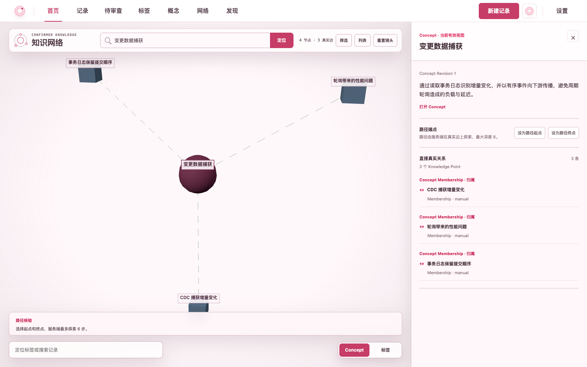
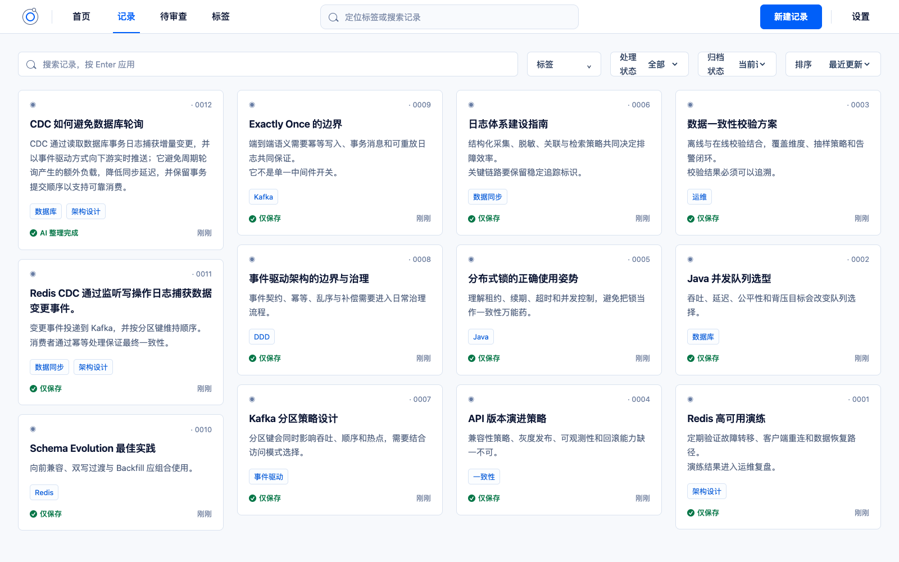
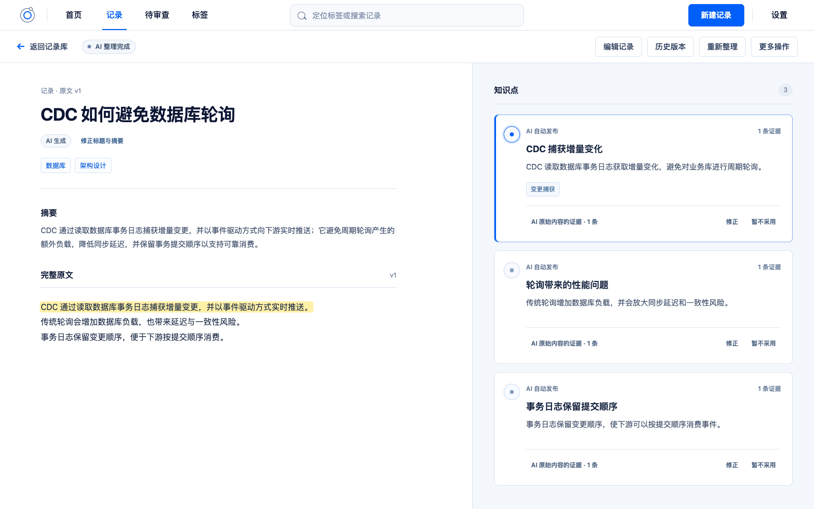
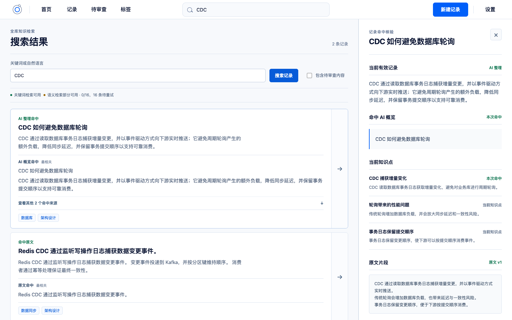

# Knowledge

一个强调原文保真、证据可回看和人机协作的个人知识库。

把零散文本保存成不可变的原文版本，再按需交给 AI 生成标题、摘要、知识点、证据片段和候选标签。AI 整理结果始终可以回到对应原文核验，也不会覆盖用户输入。



## 核心能力

- **原文优先**：首次保存和每次编辑都会创建独立版本，历史内容可持续追溯。
- **有据整理**：AI 从原文生成 1–5 个自包含知识点，每个知识点都带有可精确定位的证据片段。
- **两种处理方式**：支持自动发布，也支持进入待审查队列后逐条确认、修正或拒绝。
- **人类修正层**：用户修正不会改写 AI 原始结果，原文、AI 输出和用户认知各自保留来源。
- **统一标签体系**：手动标签与 AI 候选标签共享词表，并保留创建来源和认可状态。
- **可维护 Concept**：可以把多个当前知识点组织成稳定定义，保留定义版本、成员变更、来源状态和归档历史。
- **AI Concept 候选**：新知识生效后自动从全局知识点召回关联内容，也可一键为尚未覆盖的历史知识补做全量发现；“仅保存”不进入 Concept 关联，候选只有人工编辑并确认后才会晋级为正式 Concept。
- **功能性知识网络**：Concept Relation 先经人工审查；独立 `/network` 工作区只绘制真实有效的 Membership、Knowledge Relation 与 Concept Relation，支持节点搜索、局部展开、来源抽屉、服务端路径和键盘等价列表。
- **Concept／标签双视图首页**：首次默认展示真实 3D Concept 网络，也可随时切换到全部现存 Tag 的独立标签场；Concept 与 `/network` 共享真实边、URL、抽屉和路径，标签只用于进入记录筛选，两种语义不会混合。
- **关键词与语义检索**：同时搜索原文、AI 概览、知识点和标签，并按同一记录聚合结果。
- **完整数据管理**：支持版本历史、归档、永久删除，以及 Markdown + JSON 完整导出和恢复。

## 界面预览

### 记录库

集中浏览、筛选和管理原文与 AI 整理状态。



### 原文与知识点核验

原文和知识点并排展示；选择知识点时，可以直接定位它所引用的证据。



### 搜索与来源核验

搜索结果区分原文命中和 AI 整理命中，并在侧栏展示当前知识点与原文片段。



## 快速开始

### 使用 Docker Compose

需要 Docker Engine 与 Docker Compose。

```bash
cp .env.example .env
docker compose up --build -d
```

启动后访问 <http://127.0.0.1:18080>。

模型凭据可以写入 `.env` 作为首次启动配置，也可以稍后在设置页配置。仅保存原文不依赖 AI 模型。非本地环境必须修改数据库密码与 `MODEL_CONFIG_ENCRYPTION_KEY`，并在应用前方配置认证和 TLS。

停止服务：

```bash
docker compose down
```

### 本地开发

固定开发版本为 Node.js `24.18.1`、pnpm `11.20.0`、PostgreSQL `18` 和 pgvector `0.8.5`。

```bash
nvm use
corepack enable
pnpm install --frozen-lockfile
docker compose up -d postgres
pnpm run db:migrate
pnpm run dev
```

前端默认运行在 <http://127.0.0.1:5173>，API 默认运行在 <http://127.0.0.1:3001>。更完整的环境说明见 [本地开发文档](docs/DEVELOPMENT.md)。

生产环境可以在 `main` 验收通过后通过严格递增的版本标签触发 GitHub Actions，由其构建 amd64 镜像并通过 SSH 部署，配置方法见 [GitHub Actions 自动部署](docs/GITHUB-DEPLOYMENT.md)。

## AI 整理边界

当前版本采用“有据整理”而非自由扩写：AI 可以改写、归纳和按最小必要原则拆分原文，但不能混入原文没有提供的背景、例子、事实或新结论。知识扩展需要作为独立能力和数据层实现，不能冒充原文提炼。

文本推理端点与 Embedding 端点相互独立，均使用 OpenAI-compatible 接口，可以分别连接不同服务商。

## 真实知识网络（V3.3–V3.4）

网络节点统一使用 `concept:<uuid>` 或 `knowledge_point:<uuid>` typed key。公开读取接口为 `GET /api/v1/network/nodes/search`、`GET /api/v1/network/subgraph`、`GET /api/v1/network/nodes/:typedKey/neighbors` 和 `GET /api/v1/network/path`；只返回 `concept_membership`、`knowledge_relation`、`concept_relation` 三类真实边，并保留来源、确认记录、规范端点和路径遍历方向。

局部子图最多返回 300 个节点、600 条边并展开到深度 2；路径最多搜索深度 6、访问 1000 个节点，并受 2 秒数据库查询预算保护。Concept Relation Suggestion 可通过 API 扫描和列出，用户可以修改后确认、拒绝，或撤销已确认关系。

`/network` 默认以 Concept 为入口，选择或搜索后按需展开 Knowledge Point。2D 布局由真实 typed node key 与 edge key 确定性生成，局部展开不会移动已有节点；筛选、路径、选中对象和列表模式可由 URL 恢复。布局 Worker 或 SVG 失败时会保留当前状态并降级到键盘可操作列表。

V3.4 首页的 Concept 视图复用同一网络控制器和确定性布局：3D 原样使用 x/y，只从 typed node key 派生浅层稳定 z，不把空间深度、距离、颜色或光效解释为关系。WebGL2、初始化、帧渲染或上下文失败时保留查询、URL、选择、路径和详情状态回到功能性 2D；2D 再失败时进入等价列表。

首页可切换到独立标签场，且底部 Tag 定位与记录搜索在两个视图中始终可用：Tag 只进入既有硬筛选搜索，不成为 Concept、Knowledge Point 或知识边。合成 500 节点／1000 真实边用于 Concept 3D 表现层的最终压力验收，不改变线上 300 节点／600 边读取预算；最终验收结果以 [V3 晋级路线](docs/V3-ROADMAP.md) 的进度记录为准。

## 常用命令

| 命令 | 用途 |
| --- | --- |
| `pnpm run dev` | 同时启动前端和 API 开发服务 |
| `pnpm run db:migrate` | 应用尚未执行的数据库迁移 |
| `pnpm test` | 运行 Vitest 测试套件 |
| `pnpm run test:api` | 运行 API 测试 |
| `pnpm run test:e2e` | 运行 Playwright 端到端测试 |
| `pnpm run test:visual` | 运行视觉回归测试 |
| `pnpm run typecheck` | 执行 TypeScript 类型检查 |

## 技术栈

- React、React Router、Vite
- Fastify、PostgreSQL、pgvector
- TypeScript、Vitest、Playwright
- Docker Compose、Nginx

## 设计与领域文档

- [产品需求](PRD.md)
- [V2 → V3 晋级路线](docs/V3-ROADMAP.md)
- [领域上下文](CONTEXT.md)
- [设计规范](DESIGN.md)
- [架构决策记录](docs/adr)
- [Concept Relation 的确认、方向与复核边界](docs/adr/0034-concept-relations-require-confirmation.md)
- [功能性网络的确定性 2D 布局与降级合同](docs/adr/0035-network-workspace-uses-deterministic-2d-layout.md)
- [首页真实 3D 网络复用功能性网络合同](docs/adr/0036-home-3d-reuses-network-workspace-contract.md)
- [本地开发环境](docs/DEVELOPMENT.md)
